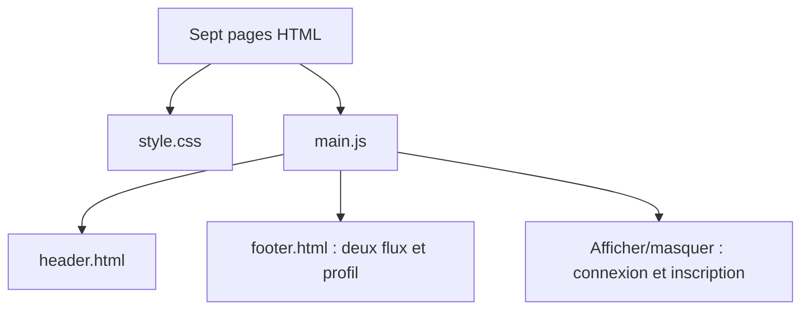

# M2 WEUX — Projet UX / Développement

Application web de parrainage destinée à faciliter l'intégration des étudiants étrangers grâce à une mise en relation avec des étudiants parrains.

## Équipe

- Alexandre
- Ange
- Steve

## Stack

- Actuellement : HTML, CSS et JavaScript natif.
- Prévu pour le backend : PHP et SQL / MySQL.

## État du projet

Au 27/10/2026, les sept pages du scaffold sont regroupées dans `frontend/public/`. Le projet reste une maquette statique en cours de construction, avec de premières interactions client.

- Flux parrain : structure sémantique, carte de demande illustrative, tags, boutons désactivés et en-tête/pied de page partagés et stylisés.
- Connexion : formulaire stylisé, panneaux de surface provisoire, silhouette de profil et liens vers la création de compte selon le rôle choisi.
- Création de compte : sélection du rôle, identifiant, e-mail et mot de passe avec champs de confirmation, regroupés en panneaux.
- Configuration du profil : nom affiché, pays, parcours et description avec compteur et limite native de 500 caractères confirmée dans le navigateur par Steve, plus six centres d’intérêt et sept besoins sélectionnables sous forme de mini-cartes. Chaque groupe possède un compteur et les actions « Tout sélectionner » / « Tout désélectionner », disposées dans une ligne flexible ; essais navigateur de ce nouvel ajout à confirmer. Choix provisoires, sans enregistrement.
- Flux étudiant : trois profils fictifs, tags, avatars, actions désactivées et actualités à venir.
- Accueil : présentation du service, étapes du parcours prévu et liens vers les formulaires et les deux espaces de démonstration.
- Profil : exemple statique de Lucia, présentation, intérêts, besoins et lien vers la configuration non préremplie. Accueil et profil restent des propositions à valider, sans écran dédié dans le wireframe V1.

Les trois pages de formulaire utilisent la même silhouette décorative et un pied de page public simplifié. Leurs soumissions restent désactivées : aucune connexion, création de compte ou sauvegarde de profil n’est disponible. Une fonction partagée compare les mots de passe et les e-mails pendant la saisie ; Steve a confirmé son fonctionnement dans le navigateur. La présélection du rôle et la validation serveur restent à implémenter.

Le CSS commun suit une approche mobile-first avec des variables de présentation provisoires. Le JavaScript charge les fragments HTML communs et permet d’afficher/masquer indépendamment les mots de passe de connexion et d’inscription, y compris la confirmation, avec une fonction réutilisable. Il ne gère pas de comptes ni de données enregistrées.

À l’inscription, un conseil textuel indique une longueur inférieure à 15 caractères ou quelques motifs prévisibles. Ce repère pédagogique n’est pas une estimation complète de robustesse ; Steve a confirmé son fonctionnement dans le navigateur.

Le backend PHP et la base de données ne sont pas encore implémentés. Une phase d’apprentissage JavaScript vanilla précède l’introduction de PHP, conformément à la demande enseignant rapportée par Steve. PHP reste prévu pour les traitements serveur ; la répartition est précisée dans le [plan](docs/plan_dev.md).

## Organisation du frontend

Les pages HTML restent à la racine de `frontend/public/` ; les styles, scripts et images sont dans `assets/`, et les fragments communs dans `includes/`.

Les formulaires, les deux flux et le profil partagent l’image `assets/images/avatar-default.svg`. Le schéma représente les dépendances de fichiers, pas le parcours utilisateur.

Le script remplace le contenu de secours des conteneurs identifiés par `site-header` et `site-footer`, lorsqu’ils existent. L’accueil et les pages de formulaire n’ont pas de conteneur `site-footer` : leur pied de page public reste local. Il ne s’agit pas encore d’un affichage conditionné par une session utilisateur.

Les sept pages disposent d’une première structure de contenu. Steve a confirmé les vérifications mobile et clavier des mini-cartes de configuration et les confirmations partagées ; cela ne constitue pas une validation exhaustive des sept pages. Suite frontend proposée : tester les compteurs et la désélection des groupes, puis reprendre la préparation PHP/SQL. Le filtrage des profils est réservé au serveur, selon la répartition convenue avec Steve. La configuration reste à adapter au rôle parrain ; navigation selon rôle et vérifications navigateur globales restent ouvertes. Les retours enseignant du 14/10 sont consignés dans le journal et à revoir dans le plan ; les schémas Mermaid et la suppression du soulignement au survol des boutons ont été appliqués ; les autres points restent à revoir.

## Lancement local

Ouvrir le dépôt dans VS Code et utiliser le Live Server déjà installé pour servir `frontend/public/fluxparrain.html` ou `frontend/public/login.html`. Conserver l’adresse HTTP locale fournie par le serveur : ouvrir directement les fichiers en `file://` ne permet pas de tester correctement le chargement des fragments avec `fetch`.

Le serveur fournit les fichiers ; le navigateur exécute JavaScript. Aucun build ni installation de dépendances applicatives n’est nécessaire. Dans l’émulation mobile des outils de développement, utiliser « Fit to window » pour voir l’intégralité du viewport simulé.

## Documentation

- [Documentation technique](docs/documentation_technique.md) : fonctionnement et périmètre du projet
- [Plan de développement](docs/plan_dev.md) : feuille de route et bilan quotidien
- [Journal de développement](docs/dev_log.md) : suivi chronologique des changements
- [Wireframes](docs/wireframes/WIREFRAME_V1.pdf) : référence fonctionnelle
