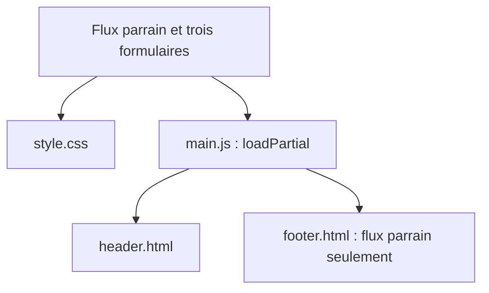

# M2 WEUX — Projet UX / Développement

Application web de parrainage destinée à faciliter l'intégration des étudiants étrangers grâce à une mise en relation avec des étudiants parrains.

## Équipe

- Alexandre
- Ange
- Steve

## Stack

- Actuellement : HTML, CSS et JavaScript natif.
- Prévu pour le backend : PHP et SQL / MySQL.

## État du projet

Au 19/10/2026, les sept pages du scaffold sont regroupées dans `frontend/public/`. Le projet reste une maquette statique en cours de construction.

- Flux parrain : structure sémantique, carte de demande illustrative, tags, boutons désactivés et en-tête/pied de page partagés et stylisés.
- Connexion : formulaire stylisé, panneaux gris, silhouette de profil et liens vers la création de compte selon le rôle choisi.
- Création de compte : sélection du rôle, identifiant, e-mail et mot de passe avec champs de confirmation, regroupés en panneaux.
- Configuration du profil : nom affiché, pays, parcours et description, plus six centres d’intérêt et sept besoins sélectionnables sous forme de mini-cartes. Choix provisoires, sans enregistrement.
- Accueil, flux étudiant et profil : placeholders à développer.

Les trois pages de formulaire utilisent la même silhouette décorative et un pied de page public simplifié. Leurs soumissions restent désactivées : aucune connexion, création de compte ou sauvegarde de profil n’est disponible. La présélection du rôle depuis les liens et la comparaison des champs de confirmation restent à implémenter.

Le CSS commun suit une approche mobile-first avec des variables de présentation provisoires. Le JavaScript charge les fragments HTML communs ; il ne gère pas encore de logique métier.

Le backend PHP et la base de données ne sont pas encore implémentés.

## Organisation du frontend

Les pages HTML restent à la racine de `frontend/public/` ; les styles, scripts et images sont dans `assets/`, et les fragments communs dans `includes/`.

Les trois formulaires partagent aussi l’image `assets/images/avatar-default.svg`. Le schéma représente les dépendances de fichiers, pas le parcours utilisateur.

Le script remplace le contenu de secours des conteneurs identifiés par `site-header` et `site-footer`, lorsqu’ils existent. Les pages de formulaire n’ont pas de conteneur `site-footer` : leur pied de page public reste local. Il ne s’agit pas encore d’un affichage conditionné par une session utilisateur.

Prochaine étape proposée : construire le flux étudiant à partir du wireframe, en réutilisant les composants existants. La configuration du profil reste à adapter au rôle parrain ; la validation visuelle complète des mini-cartes et du clavier reste à confirmer. Les retours enseignant du 14/10 sont consignés dans le journal et à revoir dans le plan ; seule leur suggestion documentaire Mermaid a été appliquée à ce stade.

## Lancement local

Ouvrir le dépôt dans VS Code et utiliser le Live Server déjà installé pour servir `frontend/public/fluxparrain.html` ou `frontend/public/login.html`. Conserver l’adresse HTTP locale fournie par le serveur : ouvrir directement les fichiers en `file://` ne permet pas de tester correctement le chargement des fragments avec `fetch`.

Le serveur fournit les fichiers ; le navigateur exécute JavaScript. Aucun build ni installation de dépendances applicatives n’est nécessaire. Dans l’émulation mobile des outils de développement, utiliser « Fit to window » pour voir l’intégralité du viewport simulé.

## Documentation

- [Documentation technique](docs/documentation_technique.md) : fonctionnement et périmètre du projet
- [Plan de développement](docs/plan_dev.md) : feuille de route et bilan quotidien
- [Journal de développement](docs/dev_log.md) : suivi chronologique des changements
- [Wireframes](docs/wireframes/WIREFRAME_V1.pdf) : référence fonctionnelle
