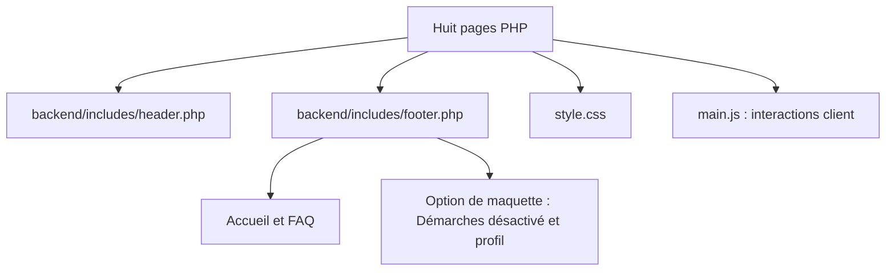

# Binô — Projet UX / Développement M2 WEUX

**Binô** est le nom provisoire, en attente de validation du groupe. Application web de parrainage destinée à faciliter l'intégration des étudiants étrangers grâce à une mise en relation avec des étudiants parrains.

## Équipe

- Alexandre
- Ange
- Steve

## Stack

- Actuellement : HTML, CSS, JavaScript natif et premières inclusions PHP.
- Prévu pour les données : SQL / MySQL via PDO.

## État du projet

Au 29/10/2026, les huit écrans sont des pages PHP dans `frontend/public/`, avec header/footer privés partagés. Les anciennes pages et fragments HTML sont supprimés après vérification progressive. Le contenu reste une maquette sans persistance ; les interactions JavaScript et la présélection PHP du rôle à l’inscription sont conservées.

- Flux parrain : structure sémantique, carte de demande illustrative, carte d’attente des actualités, tags, boutons désactivés et en-tête/pied de page partagés et stylisés.
- Connexion : formulaire stylisé, panneaux de surface provisoire, silhouette de profil et liens vers la création de compte selon le rôle choisi.
- Création de compte : sélection du rôle, identifiant, e-mail et mot de passe avec champs de confirmation, regroupés en panneaux. Identifiant de connexion limité à 24 caractères (A–Z, chiffres, _ et -) avec retour JavaScript partagé avec la connexion, distinct du nom affiché public.
- Configuration du profil : nom affiché, pays, parcours et description avec compteur et limite native de 500 caractères confirmée dans le navigateur par Steve, plus six centres d’intérêt et sept besoins sélectionnables sous forme de mini-cartes. Chaque groupe possède un compteur et les actions « Tout sélectionner » / « Tout désélectionner », disposées dans une ligne flexible et vérifiées dans le navigateur le 29/10. Choix provisoires, sans enregistrement.
- Flux étudiant : trois profils fictifs, tags, avatars, actions désactivées et actualités à venir dans une carte.
- Accueil : présentation du service, étapes du parcours prévu et liens vers les formulaires et les deux espaces de démonstration.
- Aide / FAQ : cinq réponses issues du périmètre fonctionnel et formulaire de contact de démonstration (nom, e-mail, message limité à 500 unités UTF-16 avec compteur), avec envoi désactivé.
- Profil : exemple statique de Lucia, présentation, intérêts, besoins et lien vers la configuration non préremplie. Accueil et profil restent des propositions à valider, sans écran dédié dans le wireframe V1.

Les cartes des deux flux et la présentation du profil réutilisent `.profile-heading` pour regrouper avatar circulaire, nom, rôle et études. Les informations restent fictives.

Les trois pages de formulaire utilisent la même silhouette décorative et un pied de page public simplifié. Leurs soumissions restent désactivées : aucune connexion, création de compte ou sauvegarde de profil n’est disponible. Les confirmations e-mail/mot de passe restent en JavaScript ; PHP présélectionne le rôle à partir d’une liste autorisée stricte, sans accorder de permission. La validation serveur des soumissions reste à implémenter.

Le CSS commun conserve la présentation mobile-first et la palette provisoire : fond crème, cartes saumon, header/footer jaune atténué, boutons secondaires jaunes et actions vertes. JavaScript gère révélation des mots de passe, confirmations, conseils, compteurs et sélections groupées ; son chargeur de fragments est supprimé. Aucun compte ou donnée enregistré.

À l’inscription, un conseil textuel indique une longueur inférieure à 15 caractères ou quelques motifs prévisibles. Ce repère pédagogique n’est pas une estimation complète de robustesse ; Steve a confirmé son fonctionnement dans le navigateur.

`backend/includes/header.php` et `footer.php` sont inclus par les huit pages via des chemins fixes fondés sur `__DIR__`. Un seul footer conserve les deux variantes actuelles : liens Accueil/FAQ partout, Démarches désactivé et profil sur les deux flux et le profil. Ces trois pages définissent `$showDemoNavigation = true` ; ce choix de présentation ne simule pas une session et n’accorde aucun accès. SQL, PDO et authentification restent à implémenter après accord sur le modèle de données.

## Organisation du frontend

Le header associe un duo de personnages SVG original (`assets/images/logo.svg`) au texte « Binô », centré sous le logo au sein d’un bloc aligné à gauche, en saumon avec un contour noir de 3px, comme les H1. Le jaune représente le parrain, le saumon l’étudiant ; deux SVG autonomes (`mascot-parrain.svg`, `mascot-etudiant.svg`) accompagnent les titres des flux correspondants sur leur droite, avec une hauteur fluide de 6 à 16rem et retour centré sous le titre si nécessaire. Le duo reste réservé au header. Couleurs issues des variables existantes. Au chargement, le logo du header joue une légère pulsation de 450ms, distincte du salut avec inclinaison des mascottes de flux (700ms). Chaque effet joue une fois, uniquement sans préférence de réduction des mouvements. Dans ce même mode, les cartes de profils des flux apparaissent par un fondu de 400ms et le logo du header et les boutons actifs réagissent au survol avec une souris ; aucun mouvement continu.

Les huit pages PHP restent à la racine de `frontend/public/`, avec les assets existants. Les deux fragments PHP sont dans `backend/includes/`, hors racine publique. Aucun fragment HTML public ni contenu de secours dupliqué ne reste utilisé.



Les formulaires, les deux flux et le profil partagent l’image `assets/images/avatar-default.svg`. Le schéma représente les dépendances de fichiers, pas le parcours utilisateur.

PHP assemble le header et le footer avant de transmettre le HTML au navigateur. JavaScript ne les remplace plus. La navigation de démonstration reste accessible et fictive, avec actions métier désactivées ; navigation authentifiée, contenu Démarches, menu et navigation persistante restent à définir.

**Jalon frontend statique du 29/10 atteint :** formulaires harmonisés, huit pages contrôlées dans le navigateur intégré à 320, 375, 768 et 1280px sans débordement horizontal, parcours de navigation et interactions principales vérifiés. Les échecs du chargeur de fragments ont aussi été simulés avec conservation du contenu de secours. Ce checkpoint permet de commencer une migration progressive des inclusions vers PHP ; il ne constitue pas une validation complète sur appareils physiques ni une certification d’accessibilité. Le filtrage des profils est réservé au serveur, selon la répartition convenue avec Steve. La configuration reste à adapter au rôle parrain ; navigation selon rôle et vérifications navigateur globales restent ouvertes. Les retours enseignant du 14/10 sont consignés dans le journal et à revoir dans le plan ; les schémas Mermaid, les variables d’espacement et la suppression du soulignement au survol des boutons ont été appliqués ; les autres points restent à revoir.

## Lancement local

Depuis un terminal à la racine du dépôt, lancer le serveur de développement PHP installé localement (adapter le chemin selon la machine) :

```powershell
& "C:\wamp64\bin\php\php8.3.14\php.exe" -S 127.0.0.1:8000 -t frontend/public
```

Ouvrir [l’accueil](http://127.0.0.1:8000/), [le flux parrain](http://127.0.0.1:8000/fluxparrain.php) ou [la connexion](http://127.0.0.1:8000/login.php). Garder le terminal ouvert, rafraîchir manuellement et arrêter avec Ctrl+C. Les services WAMP/MySQL ne sont pas nécessaires à cette étape.

Le serveur PHP exécute désormais les huit pages. Live Server et les URL `file://` ne permettent pas cette exécution. Le changement de prévisualisation du 28/10, puis la suppression du chargement JavaScript des fragments le 29/10, sont détaillés dans le journal. Aucun changement d’environnement ni build requis.

Le serveur fournit les fichiers ; le navigateur exécute JavaScript. Aucun build ni installation de dépendances applicatives n’est nécessaire. Dans l’émulation mobile des outils de développement, utiliser « Fit to window » pour voir l’intégralité du viewport simulé.

## Documentation

- [Documentation technique](docs/documentation_technique.md) : fonctionnement et périmètre du projet
- [Plan de développement](docs/plan_dev.md) : feuille de route et bilan quotidien
- [Journal de développement](docs/dev_log.md) : suivi chronologique des changements
- [Wireframes](docs/wireframes/WIREFRAME_V1.pdf) : référence fonctionnelle
