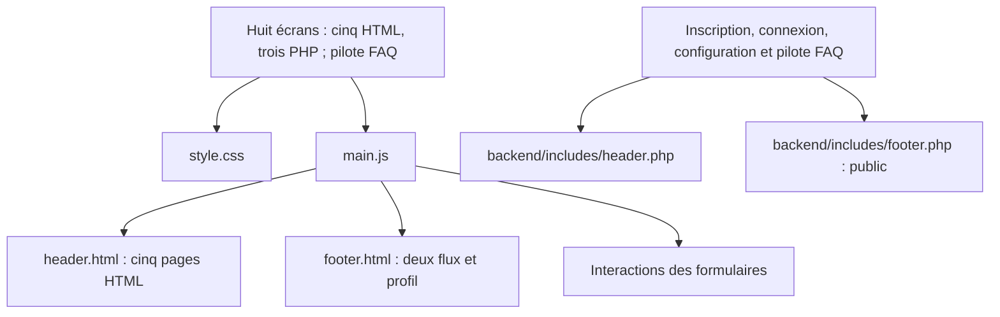

# Binô — Projet UX / Développement M2 WEUX

**Binô** est le nom provisoire, en attente de validation du groupe. Application web de parrainage destinée à faciliter l'intégration des étudiants étrangers grâce à une mise en relation avec des étudiants parrains.

## Équipe

- Alexandre
- Ange
- Steve

## Stack

- Actuellement : HTML, CSS, JavaScript natif et premières inclusions PHP.
- Prévu pour les données : SQL / MySQL via PDO.

## État du projet

Au 29/10/2026, les huit écrans sont regroupés dans `frontend/public/` : cinq pages HTML et trois pages PHP (inscription, connexion et configuration du profil). Une version pilote `aide.php` est également vérifiée, mais les liens FAQ ciblent encore `aide.html`. Le contenu reste une maquette ; les inclusions serveur sont fonctionnelles et la présélection du rôle fonctionne à l’inscription.

- Flux parrain : structure sémantique, carte de demande illustrative, carte d’attente des actualités, tags, boutons désactivés et en-tête/pied de page partagés et stylisés.
- Connexion : formulaire stylisé, panneaux de surface provisoire, silhouette de profil et liens vers la création de compte selon le rôle choisi.
- Création de compte : sélection du rôle, identifiant, e-mail et mot de passe avec champs de confirmation, regroupés en panneaux. Identifiant de connexion limité à 24 caractères (A–Z, chiffres, _ et -) avec retour JavaScript partagé avec la connexion, distinct du nom affiché public.
- Configuration du profil : nom affiché, pays, parcours et description avec compteur et limite native de 500 caractères confirmée dans le navigateur par Steve, plus six centres d’intérêt et sept besoins sélectionnables sous forme de mini-cartes. Chaque groupe possède un compteur et les actions « Tout sélectionner » / « Tout désélectionner », disposées dans une ligne flexible et vérifiées dans le navigateur le 29/10. Choix provisoires, sans enregistrement.
- Flux étudiant : trois profils fictifs, tags, avatars, actions désactivées et actualités à venir dans une carte.
- Accueil : présentation du service, étapes du parcours prévu et liens vers les formulaires et les deux espaces de démonstration.
- Aide / FAQ : cinq réponses issues du périmètre fonctionnel et formulaire de contact de démonstration (nom, e-mail, message limité à 500 unités UTF-16 avec compteur), avec envoi désactivé.
- Profil : exemple statique de Lucia, présentation, intérêts, besoins et lien vers la configuration non préremplie. Accueil et profil restent des propositions à valider, sans écran dédié dans le wireframe V1.

Les cartes des deux flux et la présentation du profil réutilisent `.profile-heading` pour regrouper avatar circulaire, nom, rôle et études. Les informations restent fictives.

Les trois pages de formulaire utilisent la même silhouette décorative et un pied de page public simplifié. Leurs soumissions restent désactivées : aucune connexion, création de compte ou sauvegarde de profil n’est disponible. Les confirmations e-mail/mot de passe restent en JavaScript ; PHP présélectionne le rôle à partir d’une liste autorisée stricte, sans accorder de permission. La validation serveur des soumissions reste à implémenter.

Le CSS commun suit une approche mobile-first avec une palette provisoire : fond crème, cartes saumon pâle, header/footer jaune atténué, boutons secondaires jaune vif et actions vertes, titres fluides avec H1 gras saumon à contour noir, H2 à accent jaune, H3 sobres et paragraphes limités à 65ch, espacements et ombres de composants centralisés en variables. Le JavaScript charge les fragments HTML communs et permet d’afficher/masquer indépendamment les mots de passe de connexion et d’inscription, y compris la confirmation, avec une fonction réutilisable. Il ne gère pas de comptes ni de données enregistrées.

À l’inscription, un conseil textuel indique une longueur inférieure à 15 caractères ou quelques motifs prévisibles. Ce repère pédagogique n’est pas une estimation complète de robustesse ; Steve a confirmé son fonctionnement dans le navigateur.

`backend/includes/header.php` et `footer.php` fournissent le header/footer public de l’inscription, de la connexion, de la configuration et du pilote FAQ. Liens entrants des trois premières pages basculés, anciennes copies HTML supprimées ; bascule des liens FAQ encore à réaliser après le checkpoint. PDO, schéma et configuration restent préparatoires, sans SQL ni authentification ; configuration privée exclue de Git. Répartition des responsabilités dans le [plan](docs/plan_dev.md).

## Organisation du frontend

Le header associe un duo de personnages SVG original (`assets/images/logo.svg`) au texte « Binô », centré sous le logo au sein d’un bloc aligné à gauche, en saumon avec un contour noir de 3px, comme les H1. Le jaune représente le parrain, le saumon l’étudiant ; deux SVG autonomes (`mascot-parrain.svg`, `mascot-etudiant.svg`) accompagnent les titres des flux correspondants sur leur droite, avec une hauteur fluide de 6 à 16rem et retour centré sous le titre si nécessaire. Le duo reste réservé au header. Couleurs issues des variables existantes. Au chargement, le logo du header joue une légère pulsation de 450ms, distincte du salut avec inclinaison des mascottes de flux (700ms). Chaque effet joue une fois, uniquement sans préférence de réduction des mouvements. Dans ce même mode, les cartes de profils des flux apparaissent par un fondu de 400ms et le logo du header et les boutons actifs réagissent au survol avec une souris ; aucun mouvement continu.

Les pages restent à la racine de `frontend/public/`. Les assets sont inchangés ; les fragments HTML publics servent les pages non migrées et les fragments PHP privés sont dans `backend/includes/`. Le pilote FAQ coexiste temporairement avec sa version HTML jusqu’à la bascule de navigation.



Les formulaires, les deux flux et le profil partagent l’image `assets/images/avatar-default.svg`. Le schéma représente les dépendances de fichiers, pas le parcours utilisateur.

Sur les cinq pages HTML, le script remplace le contenu de secours de `site-header` et, pour les deux flux et le profil, de `site-footer`. Accueil et aide HTML gardent un footer public local. Les trois pages PHP et le pilote FAQ utilisent les fragments privés sans ces IDs de chargement. Accueil et FAQ restent accessibles sur les huit écrans ; Mon profil et Démarches désactivé restent limités aux deux flux et au profil. Cette répartition est provisoire, sans contrôle de session ; menu, contenu Démarches et navigation persistante restent différés.

**Jalon frontend statique du 29/10 atteint :** formulaires harmonisés, huit pages contrôlées dans le navigateur intégré à 320, 375, 768 et 1280px sans débordement horizontal, parcours de navigation et interactions principales vérifiés. Les échecs du chargeur de fragments ont aussi été simulés avec conservation du contenu de secours. Ce checkpoint permet de commencer une migration progressive des inclusions vers PHP ; il ne constitue pas une validation complète sur appareils physiques ni une certification d’accessibilité. Le filtrage des profils est réservé au serveur, selon la répartition convenue avec Steve. La configuration reste à adapter au rôle parrain ; navigation selon rôle et vérifications navigateur globales restent ouvertes. Les retours enseignant du 14/10 sont consignés dans le journal et à revoir dans le plan ; les schémas Mermaid, les variables d’espacement et la suppression du soulignement au survol des boutons ont été appliqués ; les autres points restent à revoir.

## Lancement local

Depuis un terminal à la racine du dépôt, lancer le serveur de développement PHP installé localement (adapter le chemin selon la machine) :

```powershell
& "C:\wamp64\bin\php\php8.3.14\php.exe" -S 127.0.0.1:8000 -t frontend/public
```

Ouvrir [le flux parrain](http://127.0.0.1:8000/fluxparrain.html) ou [la connexion](http://127.0.0.1:8000/login.php). Garder le terminal ouvert, rafraîchir manuellement après modification et arrêter le serveur avec Ctrl+C. Les services WAMP ne sont pas nécessaires pour cette prévisualisation.

Ce serveur sert le frontend et exécute inscription, connexion, configuration et pilote FAQ PHP. Les cinq pages HTML utilisent encore le chargement JavaScript des fragments. Live Server est écarté : son injection de rechargement dans les SVG du fragment footer produit une réponse tronquée, constatée le 28/10. Ouvrir directement les fichiers en `file://` ne permet pas d’exécuter PHP ni de tester correctement les fragments avec `fetch`.

Le serveur fournit les fichiers ; le navigateur exécute JavaScript. Aucun build ni installation de dépendances applicatives n’est nécessaire. Dans l’émulation mobile des outils de développement, utiliser « Fit to window » pour voir l’intégralité du viewport simulé.

## Documentation

- [Documentation technique](docs/documentation_technique.md) : fonctionnement et périmètre du projet
- [Plan de développement](docs/plan_dev.md) : feuille de route et bilan quotidien
- [Journal de développement](docs/dev_log.md) : suivi chronologique des changements
- [Wireframes](docs/wireframes/WIREFRAME_V1.pdf) : référence fonctionnelle
