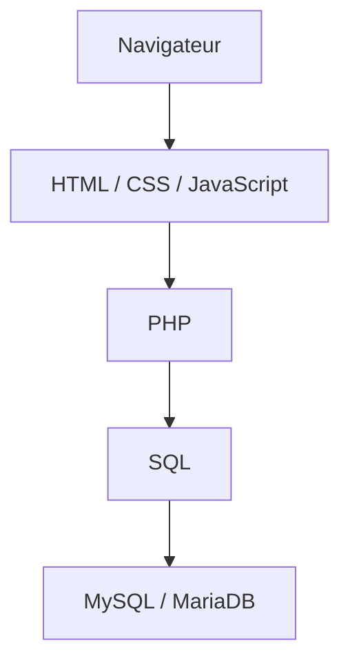
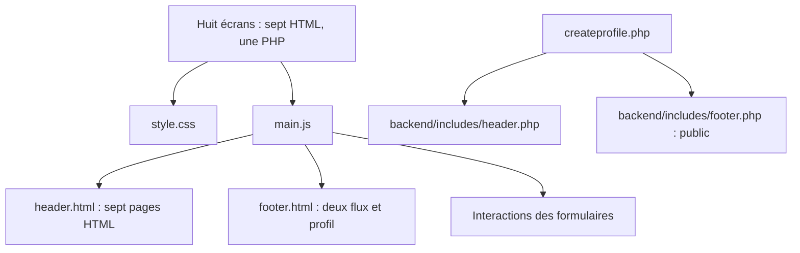
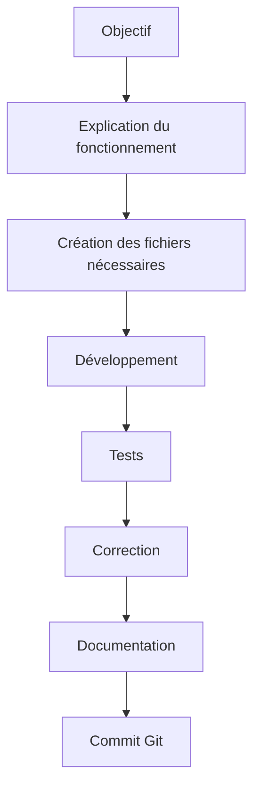
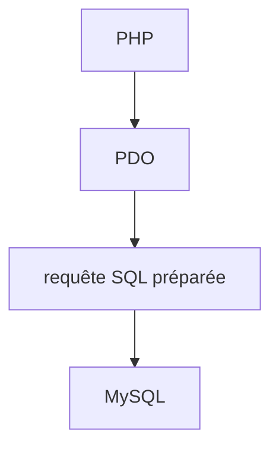
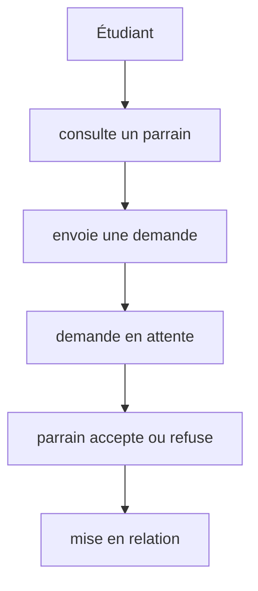
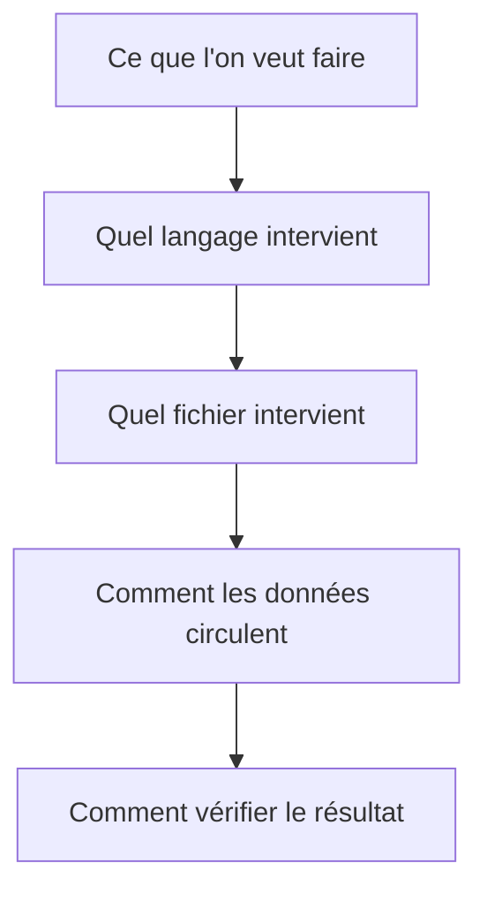
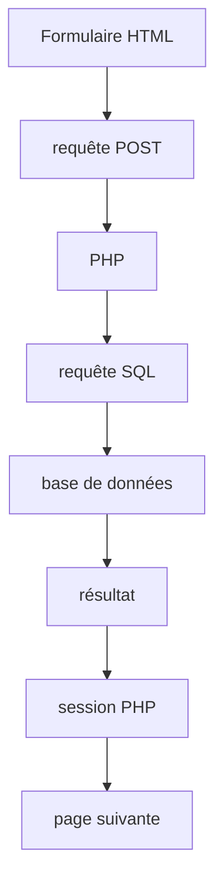
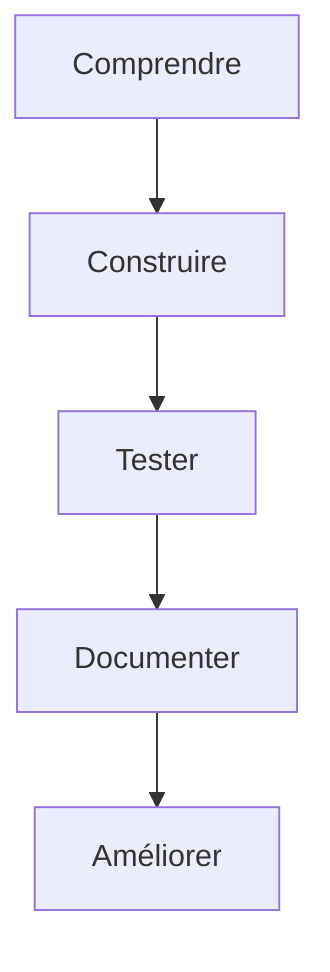

# Plan de développement — Application de parrainage

## 1. Objectif général

Nom de travail choisi par Steve le 28/10/2026 : **Binô**, en attente de validation du groupe.

Le projet consiste à développer une application web de parrainage destinée aux étudiants étrangers arrivant en France.

L'application doit permettre de faciliter leur intégration sociale, universitaire et quotidienne grâce à une mise en relation avec des étudiants parrains selon leurs profils, besoins et centres d'intérêt.

Le projet est réalisé dans le cadre du Master 2 Web éditorial et stratégie UX.

---

## 2. Philosophie de développement

Le projet sera développé avec une stack web classique afin de renforcer la compréhension des mécanismes fondamentaux du développement web.

L'objectif n'est pas uniquement d'obtenir une application fonctionnelle, mais également de comprendre comment les différentes couches communiquent entre elles.

La logique générale sera :



Contrairement aux projets réalisés avec des frameworks modernes, il n'y aura pas de compilation automatique du frontend ni d'ORM pour abstraire les requêtes SQL.

Les différentes étapes seront donc construites progressivement afin de comprendre le rôle de chaque technologie.

---

## 3. Stack technique

### Frontend

- HTML
- CSS
- JavaScript vanilla

### Backend

- PHP

### Répartition des responsabilités — décision de Steve du 20/10/2026

Privilégier PHP pour les traitements réalisables côté serveur : rendu et inclusions HTML, lecture du rôle demandé, validation des formulaires, sessions, contrôles d’accès et accès aux données via PDO/SQL. Réserver JavaScript vanilla aux interactions côté navigateur et aux éventuels appels AJAX, avec validation serveur conservée. Styles, états visuels et animations restent en CSS. Aucun framework prévu.

Le chargement actuel du header/footer par JavaScript reste une solution provisoire de la maquette statique. Sa migration vers des inclusions PHP sera réalisée lors de la mise en place explicite de l’environnement PHP. La présélection du rôle par JavaScript proposée précédemment n’est pas une prochaine étape actée : elle sera revue selon cette répartition.

**Ordre d’apprentissage précisé le 26/10/2026 :** Steve rapporte que l’enseignant souhaite une implémentation JavaScript avant PHP. Poursuivre de petites interactions client utiles, sans changer les responsabilités serveur prévues. Affichage/masquage et retour sur la correspondance des confirmations désormais implémentés comme aides immédiates ; validation PHP nécessaire lors de l’implémentation serveur. Les soumissions restent désactivées.

### Base de données

- MySQL ou MariaDB
- SQL écrit explicitement dans le code PHP
- PDO pour la connexion et l'exécution sécurisée des requêtes

### Outils complémentaires

- Git
- GitHub
- Visual Studio Code
- Figma / Figma Dev Mode
- IA comme outil d'assistance au développement, à la documentation et aux tests

### Choix volontairement exclus

Le projet ne reposera pas sur :

- React ;
- Vue ;
- Angular ;
- Laravel ;
- Node.js / Express ;
- Prisma ou autre ORM ;
- frameworks frontend ou backend similaires.

L'objectif est de travailler directement avec les technologies fondamentales du web.

---

## 4. Organisation Git

Deux branches principales sont utilisées :

```text
main
```

Branche stable correspondant aux étapes validées du projet.

```text
dev
```

Branche de développement commune à l'équipe.

---

## 5. Structure actuelle du dépôt

Au 28/10/2026, la structure versionnée de travail est la suivante :

```text
/
├── backend/
│   ├── config/
│   │   └── database.local.php.example
│   ├── includes/
│   │   ├── header.php
│   │   └── footer.php
│   ├── sql/
│   │   └── schema.sql
│   └── db.php
├── docs/
│   ├── wireframes/
│   │   └── WIREFRAME_V1.pdf
│   ├── dev_log.md
│   ├── documentation_technique.md
│   └── plan_dev.md
├── frontend/
│   └── public/
│       ├── assets/
│       │   ├── css/
│       │   │   └── style.css
│       │   ├── images/
│       │   │   ├── .gitkeep
│       │   │   ├── avatar-default.svg
│       │   │   ├── logo.svg
│       │   │   ├── mascot-etudiant.svg
│       │   │   ├── mascot-parrain.svg
│       │   │   └── icons/
│       │   │       └── navigation.svg
│       │   └── js/
│       │       └── main.js
│       ├── includes/
│       │   ├── header.html
│       │   └── footer.html
│       ├── aide.html
│       ├── createprofile.php
│       ├── fluxetudiant.html
│       ├── fluxparrain.html
│       ├── index.html
│       ├── login.html
│       ├── profil.html
│       └── profileconfiguration.html
├── .gitignore
└── README.md
```

`frontend/public/` est la racine publique : sept pages HTML et l’inscription PHP y sont placées directement ; CSS, JavaScript et images restent dans `assets/`.

Le dossier public `includes/` contient les fragments HTML chargés par `loadPartial` dans les sept pages non migrées. Les deux flux et le profil utilisent header et footer HTML ; accueil, aide, connexion et configuration gardent un footer local. L’inscription utilise les inclusions privées PHP sans cibles de remplacement JavaScript. Le contenu des huit écrans reste fictif ; le serveur PHP local permet de tester les deux mécanismes.

### Dépendances du frontend statique



Les fichiers CSS et JavaScript restent dans `assets/css/` et `assets/js/`. Les formulaires, les deux flux et le profil utilisent `assets/images/avatar-default.svg`. Le schéma distingue les fragments HTML chargés par JavaScript et les inclusions PHP de l’inscription ; il ne représente ni un parcours utilisateur ni une gestion de session.

La branche `dev` contient également les prototypes d’Alexandre et Ange dans `prototypes/`.

Les fragments `backend/includes/header.php` et `footer.php` sont utilisés par l’inscription PHP. Connexion PDO, schéma et modèle public de configuration restent préparatoires. La configuration locale `backend/config/database.local.php` est exclue de Git et omise de cette arborescence versionnée. Aucune connexion SQL, authentification ou persistance fonctionnelle.

---

# 6. Méthodologie de travail

Le projet suivra une méthodologie progressive.

Chaque phase devra idéalement respecter le cycle suivant :



Chaque étape importante sera documentée.

Les schémas de processus utilisent des blocs Mermaid ; les arborescences restent en texte. Référence : [syntaxe des flowcharts Mermaid](https://mermaid.js.org/syntax/flowchart.html).
### Travail accompagné par l’IA et critères de validation

Référence pédagogique : Yannis Delmas, *Méthode de développement d’applications*, septembre 2026, fournie par Steve. Les pratiques suivantes traduisent ses principes pour ce projet ; elles ne constituent pas une attestation de conformité ni une validation par l’enseignant.

- Avant une modification, relire le code concerné, expliquer son fonctionnement, puis définir un objectif limité et des critères observables à partir du wireframe et des scénarios.
- Conserver le rôle de formateur de l’IA : proposer de petites étapes, expliquer les choix et les compromis, puis laisser Steve mettre en œuvre le code applicatif sauf demande explicite contraire. Une note à relire ne remplace pas la compréhension ; revenir sur les mécanismes incertains avant de les étendre.
- Garder la stack simple, la mise en page mobile-first et le HTML sémantique. Utiliser les principes WCAG/RGAA comme références de vérification, sans déclarer une conformité à partir de quelques attributs ARIA.
- Après chaque étape, distinguer relecture du code, contrôles automatiques et essais navigateur. Indiquer ce qui a été vérifié, par qui, et ce qui reste à tester. L’accord de l’IA n’est pas une recette fonctionnelle ou utilisateur.
- Préférence de Steve du 29/10 : annoncer explicitement le début et la fin des essais navigateur, afficher le navigateur intégré pour qu’il puisse suivre dans le panneau Browser. Distinguer ces essais des lectures de source/simulations sans interface visible ; conserver l’onglet si Steve le demande. Utiliser Chrome lorsqu’il le demande explicitement.
- Ne pas inclure de secrets ni de données personnelles réelles dans les exemples, échanges ou documents partagés. Les responsabilités, choix et validations restent humains ; les contributions IA sont déclarées.

Pour chaque page ou comportement, préparer une courte liste de critères : contenu attendu, actions et destinations, état de maquette ou fonctionnel, petites/grandes largeurs, navigation clavier et labels, états d’erreur pertinents. Les critères non vérifiés restent ouverts. Une revue avec l’équipe et des utilisateurs représentatifs complétera les contrôles de développement.

Le travail initial directement sur `main` diffère de la recommandation avancée GitHub Flow du support (issue → branche dédiée → pull request → revue → fusion). Le workflow d’équipe sera réexaminé avant les prochaines intégrations communes ; aucune migration de branches n’est réalisée par cette décision documentaire.

---

### Sécurité dès les premières étapes PHP/SQL — 26/10/2026

Demande de Steve : intégrer la sécurité à chaque fonctionnalité dès sa construction. La revue finale de sécurité reste nécessaire, mais ne remplace pas ces contrôles progressifs. Cette liste fixe des critères à implémenter et vérifier ; elle ne décrit pas des protections déjà fonctionnelles.

| Étape | Protections à construire | Vérification attendue avant activation |
| --- | --- | --- |
| Premier serveur PHP | Racine HTTP limitée à `frontend/public/`, inclusions avec chemins locaux fixes, configuration et SQL hors racine publique ; secrets exclus de Git. | Vérifier les règles d’exclusion et l’impossibilité de télécharger les fichiers privés par HTTP, en inspectant aussi le contenu de la réponse. |
| Première connexion SQL | PDO et paramètres liés pour les valeurs ; listes de choix autorisés pour tout identifiant SQL dynamique ; compte SQL applicatif avec droits limités, distinct du compte de création du schéma. | Une valeur contenant une apostrophe reste une donnée ; les opérations SQL non autorisées au compte applicatif échouent. |
| Premier formulaire actif | Validation PHP des types, longueurs et valeurs autorisées ; encodage adapté au contexte de sortie, notamment `htmlspecialchars` pour le texte/attribut HTML ; protection CSRF vérifiée côté serveur pour les actions modifiant l’état, via POST. | Tester valeurs absentes, tableaux inattendus, texte trop long, contenu HTML et jeton CSRF absent/invalide ; aucune modification persistée en cas de rejet. JavaScript reste une aide de saisie. |
| Inscription et connexion | `password_hash` / `password_verify`, jamais de mot de passe en clair stocké ou journalisé ; politique de mot de passe serveur explicite ; limitation des tentatives et erreurs de connexion ne révélant pas l’existence d’un compte. | Vérifier empreinte stockée, refus d’identifiants incorrects et limitation effective des tentatives. Le conseil JavaScript actuel ne remplace pas ces contrôles. |
| Sessions et accès aux données | Sessions en mode strict et cookies seulement, renouvellement de l’identifiant après authentification, expiration et déconnexion ; cookies HttpOnly et SameSite, Secure en HTTPS. Autorisation vérifiée côté PHP pour chaque requête selon rôle, propriétaire et état de demande. | Tester visite anonyme, accès au profil d’un autre utilisateur, acceptation d’une demande adressée à un autre parrain, contact avant acceptation et accès après déconnexion. Ne pas se fier aux boutons masqués ni aux IDs reçus du navigateur. |
| Photo facultative et déploiement | Avant activation de l’upload : limites de taille, types réellement vérifiés, noms générés et stockage empêchant l’exécution. Avant exposition : HTTPS, versions maintenues, erreurs détaillées réservées aux journaux privés, absence de secrets dans les logs, sauvegarde et restauration testées. | Vérifier fichiers refusés, absence d’exécution des fichiers déposés, configuration HTTPS/cookies, réponse d’erreur sans détails internes et restauration d’une sauvegarde. |

Les contraintes SQL (clés étrangères, unicité, valeurs autorisées) complètent la validation PHP. Les opérations liées nécessitant une cohérence commune seront regroupées dans une transaction. Les premiers exemples restent simples et expliqués ; aucun framework ou couche de sécurité abstraite ajouté par anticipation. Distinguer protection prévue, code relu et essai réellement effectué dans le journal. La sécurité facilite l’évolution du projet ; la montée en charge demandera aussi des mesures de performances, des index et des requêtes adaptés.

Références : [OWASP — requêtes paramétrées](https://cheatsheetseries.owasp.org/cheatsheets/SQL_Injection_Prevention_Cheat_Sheet.html), [OWASP — protection CSRF](https://cheatsheetseries.owasp.org/cheatsheets/Cross-Site_Request_Forgery_Prevention_Cheat_Sheet.html), [PHP — sécurité des sessions](https://www.php.net/manual/en/features.session.security.management.php).

## 7. Documentation du développement

Plusieurs documents seront maintenus.

### Documentation technique

Décrit le produit, les fonctionnalités, les scénarios utilisateurs et le périmètre fonctionnel.

### Plan de développement

Le fichier `docs/plan_dev.md` présente la feuille de route technique, les phases prévues, les choix de stack et l'état d'avancement global.

### Journal de développement

Le fichier :

```text
docs/dev_log.md
```

retrace l'évolution technique du projet.

Pour chaque phase, il pourra contenir :

- l'objectif ;
- les fichiers créés ;
- les technologies utilisées ;
- les commandes exécutées ;
- les concepts appris ;
- les problèmes rencontrés ;
- les solutions retenues ;
- les tests effectués ;
- les décisions techniques ;
- l'état du projet en fin de phase.

### README

Le fichier `README.md` restera plus synthétique.

Il évoluera au fur et à mesure du développement et présentera notamment :

- le rôle du projet ;
- l'équipe ;
- la stack ;
- la structure principale ;
- les instructions de lancement ;
- l'état actuel du développement.

Il ne doit pas remplacer le journal de développement ni la documentation technique.

### Supports pédagogiques personnels (hors dépôt)

Les explications approfondies sur les points ayant nécessité des clarifications et une synthèse quotidienne d’apprentissage continuent d’être préparées avec Steve. Ces supports Markdown sont remis séparément pour conservation personnelle hors dépôt, sans génération planifiée automatiquement. Aucun dossier local personnel n’est imposé ni référencé dans la documentation du projet.

Pour la phase JavaScript, Steve saisit les premiers mécanismes après explication ligne par ligne ; l’IA intervient directement sur demande pour les corrections ou répétitions. La fiche de fin de journée détaille les liens HTML/JavaScript/CSS, paramètres et arguments, événements et callbacks, conditions et état du DOM, portée des variables, vérifications et questions de révision. Elle porte sur le code effectivement étudié, hors dépôt.

Rythme retenu : journal mis à jour à chaque étape ; README et plan actualisés en fin de journée. Le périmètre fonctionnel est modifié uniquement si les décisions produit évoluent.

Précision de Steve du 26/10/2026 pour PHP/SQL : avant chaque création ou modification, expliquer brièvement pourquoi ce fichier est nécessaire, qui l’appelle et à quels autres fichiers il se relie. Présenter le premier code par petits blocs avec explication de chaque ligne, puis laisser Steve le saisir et vérifier le résultat avant de poursuivre. Ces explications alimentent le bilan pédagogique quotidien hors dépôt ; ce bilan ne remplace pas l’accompagnement pendant l’exercice.

Pour limiter les doublons, le dépôt conserve la description du produit dans la documentation technique, l’état et les décisions de travail dans le plan, et l’historique factuel dans le journal. Les explications détaillées restent dans les supports personnels. Les synthèses quotidiennes portent surtout sur le code nouveau ou modifié, ses interactions et les notions à réviser ; elles ne recopient pas toute l’application chaque jour.

L’IA peut préparer et rédiger ces documents à partir des éléments fournis et des fichiers autorisés ; Steve et l’équipe en assurent la relecture, l’exactitude et la validation. La quantité de texte ne constitue pas une preuve de qualité ou de compréhension.

---

# 8. Phases de développement

## État d'avancement actuel

### Phase 0 — Repository et documentation
- [x] Repository recréé proprement
- [x] Workflow `main` / `dev` établi
- [x] Documentation technique
- [x] Wireframes
- [x] README
- [x] Journal de développement
- [x] Plan de développement

### Phase 1 — Scaffold frontend statique

- [x] Scaffold réorganisé dans `frontend/public/`
- [x] Sept pages principales identifiées et fichiers HTML préliminaires créés
- [x] Structure CSS / JavaScript / images créée
- [x] Fragments header/footer créés dans `includes/`
- [x] Chemins relatifs CSS/JavaScript vérifiés
- [x] Première structure HTML du flux parrain et carte illustrative
- [x] Base CSS commune : typographie, variables, carte, tags, boutons et header/footer
- [x] Chargement JavaScript réutilisable des fragments avec contenu de secours
- [x] Structure HTML de connexion et champs étiquetés, soumission désactivée
- [x] Première structure HTML sémantique des sept pages
- [ ] Valider les propositions accueil/profil, sans wireframe dédié
- [x] Styles réutilisables des formulaires et choix d’inscription depuis la connexion
- [x] Formulaire statique de création de compte avec champs de confirmation
- [x] Informations personnelles du profil : nom, pays, parcours et description
- [x] Panneaux de formulaire et silhouette décorative partagés
- [x] Centres d’intérêt et besoins statiques : cases natives présentées en mini-cartes
- [ ] Adapter les domaines d’aide et leur formulation au rôle parrain
- [x] Confirmer le rendu mobile et la navigation clavier des mini-cartes (confirmation de Steve)
- [ ] Présélection du rôle depuis les liens
- [x] Retour JavaScript sur la correspondance des mots de passe (simulations IA réussies, fonctionnement navigateur confirmé par Steve)
- [x] Comparaison client des e-mails par réutilisation de la fonction de confirmation (27/10 ; simulations IA réussies, fonctionnement navigateur confirmé par Steve)
- [x] Compteur de description et limite native de 500 caractères choisie par Steve (27/10 ; simulations IA réussies, fonctionnement navigateur confirmé par Steve)
- [x] Compteurs et actions « Tout sélectionner » / « Tout désélectionner » indépendantes par groupe intérêts/besoins (27/10 ; simulations IA réussies, sélection/effacement des deux groupes vérifiés dans le navigateur par l’IA le 29/10)
- [ ] Validation serveur des formulaires
- [x] Header partagé sur huit pages et footers intégrés selon le découpage provisoire
- [x] Page Aide / FAQ et formulaire de contact statique, envoi désactivé (28/10)
- [ ] Valider la navigation et le footer selon connexion/rôle
- [x] Navigation statique de démo : chemins existants et parcours principaux vérifiés le 29/10 ; navigation authentifiée à implémenter en PHP
- [x] Huit pages sans débordement horizontal à 320, 375, 768 et 1280px dans le navigateur intégré (29/10) ; appareils réels à vérifier
- [ ] Autres interactions client à définir seulement selon un besoin ; traitements métier prévus côté PHP
- [x] Afficher/masquer indépendamment les mots de passe de connexion et d’inscription avec une fonction réutilisable
- [x] Conseil textuel sur la longueur du mot de passe et quelques motifs prévisibles, sans CSS (simulations IA réussies ; fonctionnement navigateur confirmé par Steve)
- [ ] Vérifications navigateur complètes, clavier et cas d’échec du chargement

Structure actuelle : voir la section 5, « Structure actuelle du dépôt ».

**État actuel au 29/10/2026 :** les huit pages disposent d’une première structure statique. Les deux flux montrent des données fictives avec actions désactivées ; accueil et profil restent des propositions sans écran dédié dans V1. Le profil affiché n’est pas relié au formulaire. La configuration comprend informations personnelles, description limitée à 500 unités UTF-16 avec compteur, six intérêts et sept besoins provisoires. Les besoins sont encore formulés pour l’étudiant accompagné.

Le JavaScript propose révélation indépendante des mots de passe, comparaison des confirmations e-mail/mot de passe, conseil pédagogique de mot de passe et compteurs/actions de sélection par groupe. Les soumissions restent désactivées : aucun compte, session, enregistrement ni contrôle d’accès. La présélection du rôle et la validation serveur restent à implémenter ; le filtrage des profils est réservé à PHP/SQL. Décision du 28/10 : nom de connexion distinct du nom affiché public ; identifiant limité à 24 caractères, lettres A–Z, chiffres, underscore et tiret, sans espace. Contraintes HTML et feedback JavaScript partagé présents à l’inscription et à la connexion, contrôle PHP et unicité à implémenter ; nom affiché autorisant espaces/accents.

La présentation utilise la palette provisoire : fond crème, cartes saumon pâle, header/footer jaune atténué, boutons secondaires jaune vif et actions vertes, une hiérarchie de titres fluide, `--space` pour les espacements et `--shadow-raised` pour le relief des cartes/boutons. Le footer reste dans le flux normal : icône Accueil et lien Aide / FAQ sur huit pages, icône Mon profil sur les deux flux et le profil seulement. Les variantes publiques restent locales et sans lien profil ; cette répartition par page n’est pas un contrôle de session. Sprite local `navigation.svg`, classe `.icon` et variable `--color-icon` réutilisés. Intégration progressive reprise le 28/10 ; Aide / FAQ dispose de cinq réponses et d’un formulaire de contact de démonstration (nom, e-mail, message limité à 500 unités UTF-16 avec compteur) avec envoi désactivé ; aucune sélection de catégorie ajoutée. Démarches est présent comme bouton à icône désactivé sur les deux flux et le profil ; son contenu et le burger restent à construire. Contrôles footer à icônes seules, nommés par aria-label, dimensions communes de 2.75rem. Navigation persistante toujours différée.

**Vérifications au 29/10 :** confirmations et révélations de mots de passe, username, compteurs/limites de 500 et deux groupes de sélection vérifiés dans le navigateur intégré par l’IA ; parcours clavier ciblés sur connexion et configuration. Steve a confirmé les comportements des étapes précédentes. Huit pages contrôlées à quatre largeurs ; erreurs du chargeur simulées en Node avec fallback conservé. Appareils physiques, autres moteurs, préférence reduced-motion réellement activée et revue d’accessibilité exhaustive restent ouverts. Les essais et leurs auteurs sont détaillés dans le journal.

**Backend :** inscription migrée vers `createprofile.php`, avec inclusions privées header/footer exécutées et vérifiées. Liens entrants basculés et ancienne copie HTML supprimée. Les sept autres pages gardent leurs fragments JavaScript. PDO, SQL, sessions et persistance non implémentés ; paramètres de rôle transmis mais encore ignorés.

**Prochaine étape proposée :** checkpoint des inclusions à commiter par Steve, puis lecture/validation du paramètre GET et présélection du rôle, par petites étapes saisies manuellement et exécutées immédiatement. Avant authentification et SQL, préciser casse du username, données obligatoires, rôles et accès ; appliquer les critères de sécurité de la section 6. Étendre les inclusions progressivement sans modifier les variantes de navigation par anticipation.

**Décisions reportées :** direction artistique finale, navigation selon connexion/rôle, destinations démarches/mentions légales, placement du footer en bas des pages courtes. Le footer reste dans le flux normal. L’absence de lien vers un profil sur la connexion est une décision d’interface, pas un contrôle d’accès : les protections réelles seront implémentées côté PHP.

**Navigation — décision de Steve du 27/10/2026 :** conserver la navigation principale dans le footer pour le moment, conformément à l’orientation du wireframe. Le header garde l’identité du projet et le lien d’accueil. Destinations exactes et variantes publique/étudiant/parrain restent à définir ; leur sélection sera gérée par PHP lors de l’implémentation des sessions et rôles. Cette décision ne rend pas le footer fixe et n’ajoute pas de contrôle d’accès côté client.

**Piste de navigation discutée le 28/10 :** contrôle profil avec icône générique vers la connexion pour un visiteur, avatar vers le profil pour un utilisateur connecté et avatar par défaut si aucune photo. À préciser et implémenter côté PHP à partir de la session lors de l’authentification ; aucun comportement conditionnel ni chargement de photo actuellement. Le burger reste en attente d’un contenu utile.

- [ ] Revenir sur l’idée d’une navigation persistante en bas du viewport mobile. Discussion mise en attente par Steve le 27/10 ; aucun choix de positionnement engagé. Le footer reste dans le flux normal en attendant cette revue.

- [x] Style et centrage des contrôles footer : boutons communs et icônes seules, cibles de 44 × 44px à la taille de base. Tests IA à 375px, environ 393px et 1280px ; Steve confirme le résultat (28/10). Revue clavier globale toujours ouverte.

### Jalon de transition frontend → PHP — 29/10/2026

Périmètre atteint : une base statique cohérente pour intégrer le serveur, avec données fictives et soumissions désactivées. Ce n’est pas la fin des tests ni une application prête à être publiée.

| Contrôle | Résultat et limite |
| --- | --- |
| Huit pages, assets et fragments | Structure, labels, identifiants, chemins locaux et références SVG vérifiés ; fallbacks identiques aux fragments. |
| Mise en page | 32 contrôles page/largeur : 320, 375, 768, 1280px, sans débordement horizontal dans le navigateur intégré. |
| Formulaires | Notes au début, champs requis/facultatifs explicites ; limites et feedback client fonctionnels, aucun enregistrement. |
| Clavier et navigation | Tab/Espace/Entrée testés sur les contrôles ciblés, liens de démo parcourus ; revue exhaustive et appareils réels encore ouverts. |
| Chargeur | Succès, HTTP 404, rejet réseau, échec de lecture et conteneur absent simulés avec le code réel ; fallback préservé en cas d’erreur. |

Les notes de configuration décrivent volontairement le profil étudiant accompagné et les champs facultatifs de cette maquette, sans acter les futures obligations métier. Cas d’erreur serveur, contrôle de session, rôle du footer, accès aux coordonnées et persistance appartiennent aux prochains incréments PHP.

Pistes de pages à discuter après ce jalon, sans engagement ni fichier créé :

| Page possible | Intérêt |
| --- | --- |
| Détail d’un parrain | Consulter un profil complet avant d’envoyer une demande ; réutiliser la présentation de profil existante. |
| Mes demandes / mon parrainage | Distinguer demandes en attente, refusées et acceptées ; contact accessible seulement après acceptation. |
| Démarches et ressources | Donner un contenu au contrôle footer actuel ; contenu éditorial à définir avec le groupe. |
| Récupération d’accès | Compléter le futur parcours d’authentification ; à concevoir avec le backend. |

Menu burger toujours différé faute de raccourcis définis ; mentions légales déjà réservées dans le footer, contenu à préparer séparément. Aucun écran additionnel requis avant de commencer les inclusions PHP.

### Phase 2 — Intégration UX/UI depuis Figma
Commencée partiellement en parallèle de la phase 1 : première intégration depuis le wireframe V1 sur les deux flux, la connexion, la création de compte et la configuration du profil ; accueil et profil proposés sans écran dédié. Les sept pages initiales ont du contenu ; une page Aide / FAQ a été ajoutée le 28/10. Direction artistique, proportions et détails du wireframe restent à valider. Les actualités restent une réservation visuelle dans une carte sur chacun des deux flux, sans contenu ni chargement dynamique.

### Phase 3+ — PHP / SQL / authentification / données dynamiques
Premières inclusions fonctionnelles vérifiées sur l’inscription ; PDO, SQL et authentification non commencés. Voir la section 5 et les entrées du journal du 29/10.

### Retour enseignant du 14/10/2026 — à revisiter

La synthèse des suggestions de Yannis Delmas est conservée dans `docs/dev_log.md`, à la date du 14/10/2026. Les schémas Mermaid ont été appliqués ; le 20/10, Steve a également demandé la suppression du soulignement au survol des éléments `.button`, en conservant les liens de navigation présentés en boutons et leur focus clavier.

- [x] Retirer le soulignement au survol des boutons et liens `.button`, sans supprimer le focus clavier (20/10).
- [x] Centraliser les espacements de mise en page avec une unité `--space` et ses multiples/fractions (27/10) ; détails de padding des contrôles conservés pour cette passe.
- [ ] Reprendre les autres points de cette synthèse avec Steve : ARIA et nom de navigation, classes/IDs des boutons, présentation des liens, curseurs, sélecteurs de pseudo-éléments, inclusions PHP et rôle de JavaScript/AJAX. Ces autres ajustements restent à revoir ; aucune date fixée.

**Décision de Steve :** conserver pour l’instant le chargement client du header/footer en JavaScript et l’environnement de prévisualisation actuel. Reporter l’introduction de PHP ainsi que les autres ajustements suggérés à une prochaine revue ; aucune migration ni refonte des contrôles engagée.


---

## Phase 0 — Repository et documentation

Objectif : disposer d'une base de travail propre avant le développement.

Contenu :

- création du dépôt ;
- branches `main` et `dev` ;
- documentation technique ;
- wireframes ;
- dossiers de prototypes ;
- README initial ;
- journal de développement.

À cette étape, aucun développement applicatif important n'est encore réalisé.

---

## Phase 1 — Scaffold frontend statique

Objectif : construire la structure initiale de l'application sans PHP ni base de données.

Technologies :

- HTML ;
- CSS ;
- JavaScript.

Travail prévu :

- définir les pages principales ;
- créer les fichiers HTML ;
- créer la feuille de style principale ;
- créer le fichier JavaScript principal ;
- établir la navigation entre les pages ;
- définir les éléments visuels communs ;
- préparer les dossiers d'images et autres ressources.

Structure et état d’avancement actuels : voir la section 5 et la rubrique « État d’avancement actuel » de la section 8.

---

## Phase 2 — Intégration UX/UI depuis Figma

Objectif : transformer progressivement les wireframes en interfaces web fonctionnelles.

Pour chaque page :

1. analyser l'objectif de la page ;
2. identifier les informations affichées ;
3. définir la structure HTML ;
4. appliquer le CSS ;
5. rendre l'interface responsive ;
6. ajouter les interactions JavaScript nécessaires ;
7. identifier les éléments qui deviendront dynamiques avec PHP.

Les prototypes d'Alexandre et Ange pourront être utilisés comme base ou référence lorsque leur travail est pertinent pour l'application principale.

---

## Phase 3 — Introduction de PHP

Objectif : commencer à rendre les pages dynamiques.

**Incrément vérifié le 29/10/2026 :** inscription `createprofile.php` avec inclusions privées de `header.php` et `footer.php`, sans cibles de remplacement JavaScript. Un seul couple de fragments PHP retenu par Steve ; footer public à ce stade, conditions de session ultérieures. PHP exécuté, sortie comparée au HTML et navigation testée dans le navigateur intégré. Les quatre liens entrants ciblent PHP et l’ancienne copie HTML est supprimée. Aucun fichier d’exercice ni variante publique supplémentaire créé. Lecture GET et présélection encore non implémentées.

### Migration progressive proposée après revue du 28/10/2026

**Bascule vérifiée le 29/10 :** les quatre liens entrants d’inscription dans accueil, FAQ et connexion ciblent `createprofile.php`. Parcours testés dans le navigateur intégré ; paramètres étudiant/parrain conservés. Ancienne copie HTML retirée par Steve et absence de références applicatives contrôlée. La présélection reste le prochain exercice.

Conserver le serveur PHP local, la racine `frontend/public/` et les assets. Il sert sept pages HTML et exécute l’inscription PHP. La cartographie et l’ordre proposés ci-dessous datent de la revue initiale du 28/10 ; l’incrément ci-dessus fait foi pour les choix depuis réalisés ou remplacés, notamment absence de page d’exercice et couple unique de fragments PHP.

**Dépendances actuelles vérifiées :**

- Toutes les pages chargent `main.js`, `style.css` et le header via `site-header`. Le header et les huit footers proposent Accueil ; les huit footers proposent FAQ.
- `fluxetudiant.html`, `fluxparrain.html` et `profil.html` chargent `includes/footer.html` via `site-footer`, avec trois copies de secours concordantes : Accueil, FAQ, Démarches désactivé, Mon profil. Les cinq autres pages gardent leur footer public local : Accueil et FAQ.
- L’accueil mène à connexion, inscription et aux deux flux de démonstration. Connexion mène à inscription avec `?role=etudiant` ou `?role=parrain` ; FAQ mène aussi à inscription ; inscription revient à connexion. Profil mène à configuration et au flux étudiant. Configuration ne sauvegarde rien et son retour se fait actuellement par la navigation commune, sans retour profil dédié.
- Les confirmations, révélations de mots de passe, compteurs et sélections groupées dépendent des IDs des champs, des groupes et de leurs attributs, pas de l’extension HTML/PHP. Aucun routage JavaScript ni session ; paramètres de rôle encore ignorés. Classes CSS du header/footer indépendantes des IDs utilisés par le chargeur.

**Ordre proposé, un objectif vérifiable à la fois :**

1. Créer manuellement `frontend/public/essai.php`, sans lien depuis la navigation, pour constater une réponse produite par PHP. Puis étudier séparément une inclusion fixe vers `backend/includes/header.php`, avec `require` et un chemin fondé sur `__DIR__`. Remplir le header préparatoire à cette étape seulement ; pas de donnée utilisateur dans le chemin. Vérifier rendu, liens et réponse HTML avant toute conversion réelle.
2. Préparer `createprofile.php` au même niveau que la page HTML comme première page pilote, avec formulaire toujours inactif et IDs/classes/assets conservés. Ne pas modifier les liens entrants avant comparaison. Migrer uniquement le header en premier ; conserver le footer public local. Sur cette version, retirer l’ID de ciblage `site-header` du header rendu par PHP, en conservant ses classes : le garde existant de `loadPartial` empêche alors le fetch de le remplacer. Vérifier qu’aucune autre dépendance ne réclame cet ID avant retrait. Même principe pour `site-footer` lors de sa migration ultérieure.
3. Après validation de la page pilote, basculer ensemble ses liens entrants dans accueil, connexion et FAQ vers `createprofile.php`, en conservant les deux paramètres `role`. Retirer ensuite la copie HTML devenue inutile après contrôle des références ; ne pas entretenir deux versions divergentes. Si d’anciennes URL partagées doivent rester utilisables, définir un mécanisme de redirection adapté au serveur avant retrait. Conversion et changement d’URL ne sont pas une activation de l’inscription.
4. Étendre les inclusions page par page. Conserver explicitement les deux variantes de footer ; ajouter un fragment PHP public seulement lorsqu’il est utilisé, sans simuler une session à partir du nom de page. À chaque changement d’URL, contrôler liens du contenu, fragments HTML encore utilisés et fallbacks. Migrer l’accueil avec vérification particulière de `/` et `/index.html` pour éviter l’ambiguïté entre deux index. Supprimer le chargeur JavaScript et les fragments HTML seulement lorsqu’aucune page n’en dépend plus ; conserver les interactions client.
5. Sur l’inscription migrée, introduire la lecture de `role` via GET comme petit comportement serveur distinct : accepter uniquement une chaîne `etudiant` ou `parrain`, sinon laisser le choix vide. La présélection reste un choix de formulaire, jamais une preuve d’autorisation. Tester paramètre absent, inconnu et sous forme de tableau ; soumission encore désactivée.
6. Valider ensuite le modèle relationnel et les règles métier, puis première connexion PDO et inscription sécurisée, connexion/session, autorisations, profil et demandes. Appliquer les critères de sécurité de la section 6 avant activation de chaque traitement. Lors de l’introduction des contrôles d’accès, retirer/protéger toute ancienne copie HTML présentant des données privées ; conserver les exemples publics uniquement s’ils restent fictifs et clairement annoncés.

**Vérification à chaque bascule :** accès direct à la nouvelle URL et liens entrants/sortants, réponses HTTP et assets/SVG, header/footer présents une seule fois sans remplacement JavaScript, variantes de navigation conservées, absence de code PHP brut dans la réponse, interactions client de la page, clavier/mobile et formulaires encore inactifs tant que leur traitement n’est pas construit. Tracer séparément contrôles source/HTTP, simulations et essais navigateur. Les chemins d’inclusion sont des chemins disque ; les `href`/`src` rendus restent des URL relatives à la page demandée, pas au dossier `backend/includes/`.

Références pédagogiques : [PHP — require](https://www.php.net/manual/en/function.require.php), [PHP — __DIR__](https://www.php.net/manual/en/language.constants.magic.php).

Les pages HTML pourront progressivement être converties :

```text
login.html
```

vers :

```text
login.php
```

Cette phase permettra d'étudier :

- le fonctionnement d'un serveur PHP ;
- l'exécution du PHP côté serveur ;
- la génération de HTML par PHP ;
- les variables ;
- les conditions ;
- les boucles ;
- les inclusions ;
- les formulaires ;
- `GET` et `POST`.

La structure pourra commencer à intégrer des éléments réutilisables :

```text
includes/
├── header.php
├── footer.php
└── navigation.php
```

---

## Phase 4 — Conception de la base de données

Objectif : concevoir la structure relationnelle permettant de stocker les informations de l'application.

Technologies :

- MySQL ou MariaDB ;
- SQL ;
- PHP PDO.

Le modèle de données devra notamment représenter :

- les utilisateurs ;
- les profils ;
- les étudiants étrangers ;
- les parrains ;
- les centres d'intérêt ;
- les besoins ;
- les langues ;
- les demandes de parrainage ;
- les relations entre utilisateurs.

Le modèle sera conçu avant d'implémenter les requêtes applicatives.

---

## Phase 5 — Connexion PHP / SQL

Objectif : apprendre à connecter directement PHP à la base de données.

La connexion sera réalisée avec PDO.

Exemple de logique :



Les requêtes seront écrites explicitement.

Exemples :

```sql
SELECT
INSERT
UPDATE
DELETE
```

L'objectif est de comprendre précisément les opérations que les ORM masquent habituellement.

---

## Phase 6 — Comptes et authentification

Objectif : permettre aux utilisateurs de créer un compte et de se connecter.

Fonctionnalités envisagées :

- inscription ;
- connexion ;
- déconnexion ;
- sessions PHP ;
- stockage sécurisé des mots de passe ;
- vérification des identifiants ;
- contrôle de l'accès à certaines pages.

Cette phase permettra notamment de travailler :

- les formulaires ;
- `$_POST` ;
- les sessions ;
- les cookies si nécessaire ;
- `password_hash()` ;
- `password_verify()` ;
- les requêtes SQL préparées.

---

## Phase 7 — Gestion des profils

Objectif : rendre les profils étudiants et parrains réellement dynamiques.

Fonctionnalités :

- création du profil ;
- modification du profil ;
- consultation du profil ;
- centres d'intérêt ;
- besoins ;
- langues ;
- disponibilités ;
- informations universitaires.

Les pages statiques construites précédemment commenceront alors à afficher des données provenant réellement de la base de données.

---

## Phase 8 — Système de mise en relation

Objectif : proposer des parrains adaptés aux étudiants étrangers.

Le matching restera initialement simple et explicable.

Il pourra s'appuyer sur :

- centres d'intérêt communs ;
- besoins ;
- langues ;
- domaine d'études ;
- disponibilité.

Les résultats seront obtenus grâce à des requêtes SQL et à une logique PHP claire.

Aucune intelligence artificielle ou machine learning n'est nécessaire pour le MVP.

---

## Phase 9 — Demandes de parrainage

Objectif : permettre à un étudiant étranger de demander une mise en relation avec un parrain.

Cycle prévu :



Fonctionnalités envisagées :

- envoi de demande ;
- consultation des demandes ;
- acceptation ;
- refus ;
- affichage du statut ;
- déblocage des informations de contact après acceptation.

---

## Phase 10 — Intégration et tests

Objectif : vérifier que toutes les parties fonctionnent ensemble.

Tests prévus :

- navigation ;
- formulaires ;
- authentification ;
- profils ;
- requêtes SQL ;
- matching ;
- demandes ;
- comportements incorrects ;
- erreurs utilisateur ;
- responsive ;
- cohérence UX.

Cette phase permettra également de corriger les problèmes détectés au fil du développement.

---

## Phase 11 — Finalisation et déploiement

### Hébergement à revoir — point du 26/10/2026

- Selon Steve, l’enseignant demande un hébergement sur Azrael, serveur de l’école. Obtenir les consignes avant de fixer la procédure : version PHP, disponibilité MySQL/MariaDB et accès, transfert des fichiers, HTTPS, racine publique et possibilité de conserver le backend hors de cette racine.
- Steve envisage un hébergement précoce pour partager les essais. Proposition à examiner : déployer d’abord la maquette statique dans un espace de test Azrael, puis introduire progressivement PHP avec des données fictives et une base de développement séparée. Ce contrôle d’environnement peut intervenir avant la finalisation.
- Vercel reste une option temporaire pour la maquette statique si l’accès Azrael tarde ; aucun choix effectué. Son runtime PHP communautaire et son fonctionnement en fonctions demanderaient une adaptation à évaluer pour le backend. Références consultées : [déploiements Vercel](https://vercel.com/docs/deployments/overview), [runtimes Vercel](https://vercel.com/docs/functions/runtimes).
- Discussion mise en attente à la demande de Steve : aucun compte créé, déploiement, configuration d’hébergement ou installation effectué. Conserver le workflow local actuel et reprendre ce point lorsque les informations Azrael seront disponibles.

Objectif : préparer une version finale démontrable.

Travail prévu :

- nettoyage du code ;
- finalisation UX/UI ;
- vérification de la sécurité ;
- tests complets ;
- finalisation du README ;
- finalisation de la documentation ;
- préparation du déploiement ;
- préparation de la démonstration.

---

# 9. Méthode d'apprentissage

Le projet sera également utilisé comme exercice d'apprentissage du développement web classique.

Pour chaque nouveau mécanisme important, le développement devra permettre de comprendre :



Par exemple, pour une connexion :



L'objectif est de ne pas uniquement obtenir du code fonctionnel, mais également de pouvoir expliquer son fonctionnement.

---

# 10. Utilisation de l'intelligence artificielle

L'IA peut être utilisée pour :

- préparer les étapes ;
- expliquer les concepts ;
- proposer du code ;
- corriger des erreurs ;
- analyser les bugs ;
- préparer des tests ;
- générer de la documentation ;
- accélérer les tâches répétitives.

Cependant, pendant les premières implémentations importantes, l'objectif sera de conserver une forte implication manuelle.

Avant d'automatiser des tâches similaires avec des agents, il est préférable d'avoir réalisé et compris au moins une fois les mécanismes fondamentaux tels que :

- une page HTML complète ;
- un formulaire PHP ;
- une connexion PDO ;
- une requête `SELECT` ;
- une requête `INSERT` ;
- une requête `UPDATE` ;
- une authentification avec session ;
- une relation entre plusieurs tables SQL.

Les agents pourront ensuite être utilisés pour accélérer les tâches répétitives tout en conservant une architecture comprise par l'équipe.

---

# 11. Principe général

La priorité du projet est :



L'application sera donc construite progressivement, sans chercher à créer dès le départ une architecture complète ou trop abstraite.

Chaque phase doit laisser le projet dans un état compréhensible, testable et documenté avant de passer à la suivante.


