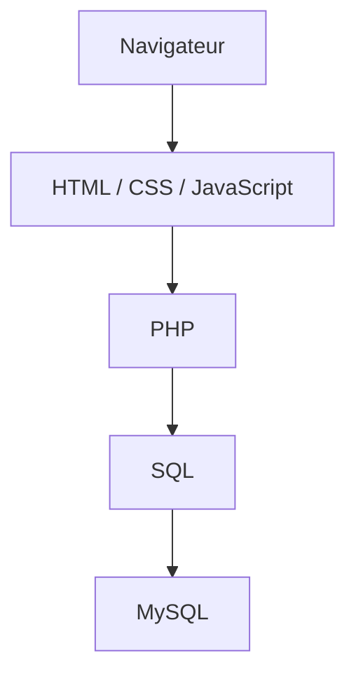
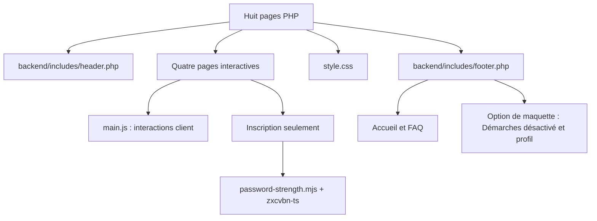
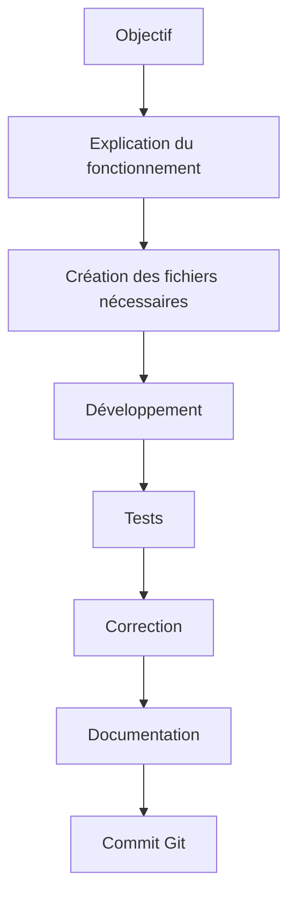
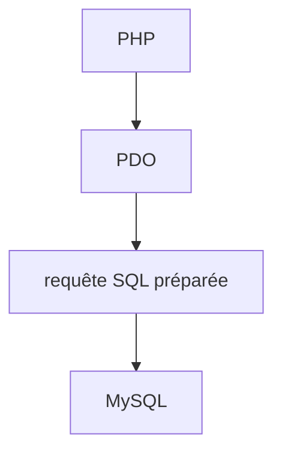
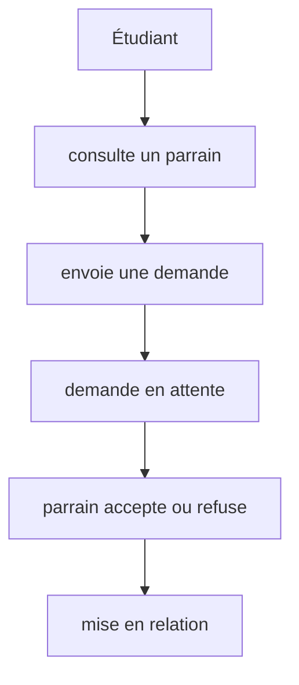
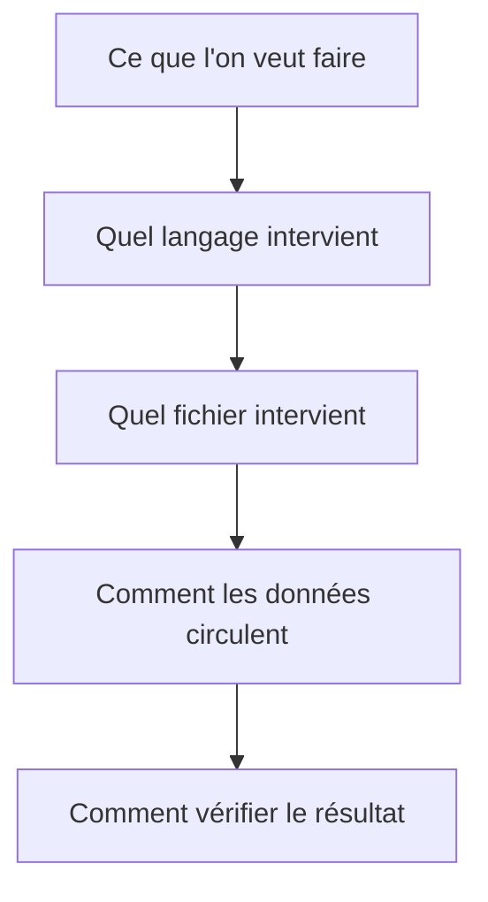
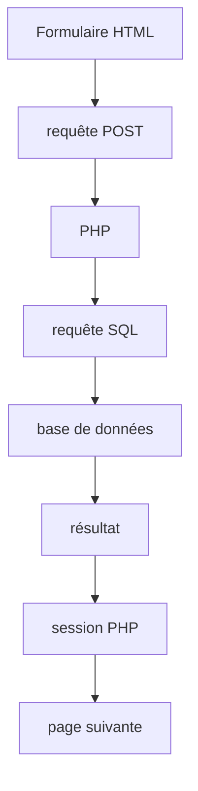
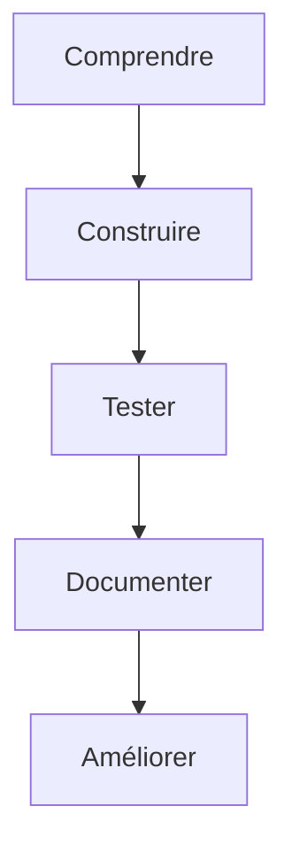

# Plan de développement — Application de parrainage

## Priorités actuelles

1. À partir du questionnaire d’équipe, définir les champs requis du profil et les tags propres à chaque rôle. Préciser le lien entre compte et profil et les règles de compte encore ouvertes. Le nom d’utilisateur est prévu comme unique et enregistré en minuscules.
2. Préparer le modèle MySQL et le premier essai PDO, puis valider, enregistrer et relire un profil par PHP. Prévoir l’identification du compte et le contrôle du propriétaire avant d’activer la sauvegarde pour un utilisateur connecté.
3. Reprendre l’édition sur place une fois la sauvegarde de profil opérationnelle. Raccorder les actions AJAX des demandes lorsque PHP pourra les autoriser et enregistrer leurs changements d’état. La notification d’acceptation reste dans le lot 2.

La passe JavaScript du 12/11 est terminée. Les suites de la revue HTML/CSS et la mise en forme du retour de robustesse restent reportées.

## 1. Objectif général

Nom de travail choisi par Steve le 28/10/2026 : **Binô**, en attente de validation du groupe.

Le projet consiste à développer une application web de parrainage destinée aux étudiants étrangers arrivant en France.

L'application doit permettre de faciliter leur intégration sociale, universitaire et quotidienne grâce à une mise en relation avec des étudiants parrains selon leurs profils, besoins et centres d'intérêt.

Le projet est réalisé dans le cadre du Master 2 Web éditorial et stratégie UX.

---

## 2. Philosophie de développement

Le projet sera développé avec une stack web classique afin de renforcer la compréhension des mécanismes fondamentaux du développement web.

L'objectif n'est pas uniquement d'obtenir une application fonctionnelle, mais également de comprendre comment les différentes couches communiquent entre elles.

La logique générale sera :



Contrairement aux projets réalisés avec des frameworks modernes, il n'y aura pas de compilation automatique du frontend ni d'ORM pour abstraire les requêtes SQL.

Les différentes étapes seront donc construites progressivement afin de comprendre le rôle de chaque technologie.

---

## 3. Stack technique

### Frontend

- HTML
- CSS
- JavaScript vanilla

### Backend

- PHP

### Répartition des responsabilités — décision de Steve du 20/10/2026

Privilégier PHP pour les traitements réalisables côté serveur : rendu et inclusions HTML, lecture du rôle demandé, validation des formulaires, sessions, contrôles d’accès et accès aux données via PDO/SQL. Réserver JavaScript vanilla aux interactions côté navigateur et aux éventuels appels AJAX, avec validation serveur conservée. Styles, états visuels et animations restent en CSS. Aucun framework prévu.

Sur `main`, les huit pages utilisent les inclusions PHP pour l’en-tête et le pied de page. PHP présélectionne aussi le rôle dans le formulaire d’inscription à partir d’une liste autorisée. Ce choix initialise le formulaire. Les autorisations relèveront des futurs traitements de compte et de session.

**Ordre d’apprentissage précisé le 26/10/2026 :** Steve rapporte que l’enseignant souhaite une implémentation JavaScript avant PHP. Poursuivre de petites interactions client utiles, sans changer les responsabilités serveur prévues. Affichage/masquage et retour sur la correspondance des confirmations désormais implémentés comme aides immédiates ; validation PHP nécessaire lors de l’implémentation serveur. Les soumissions restent désactivées.

### Base de données

- MySQL, administré avec phpMyAdmin. Version cible sur Azraël à confirmer.
- SQL écrit explicitement dans le code PHP
- PDO pour la connexion et l'exécution sécurisée des requêtes

### Outils complémentaires

- Git
- GitHub
- Visual Studio Code
- Figma / Figma Dev Mode
- IA comme outil d'assistance au développement, à la documentation et aux tests

### Choix volontairement exclus

Le projet ne reposera pas sur :

- React ;
- Vue ;
- Angular ;
- Laravel ;
- Node.js / Express ;
- Prisma ou autre ORM ;
- frameworks frontend ou backend similaires.

L'objectif est de travailler directement avec les technologies fondamentales du web.

---

## 4. Organisation Git

- `main` contient la version PHP du projet.
- `dev` intègre la version PHP depuis la fusion du 19/11/2026 (PR #6).

La fusion a aligné le contenu des deux branches. Leurs commits peuvent ensuite évoluer séparément. Le checkpoint HTML reste accessible au commit `c453c1c`. Le [README](../README.md#lancement-local) indique comment lancer les versions actuelles et consulter ce checkpoint. Le workflow des prochaines intégrations reste à discuter avec le groupe.

---

## 5. Structure actuelle du dépôt

Structure au 19/11/2026, après migration PHP et refactorisation JavaScript :

```text
/
├── backend/
│   ├── config/
│   │   └── database.local.php.example
│   ├── includes/
│   │   ├── header.php
│   │   └── footer.php
│   ├── sql/
│   │   └── schema.sql
│   └── db.php
├── docs/
│   ├── wireframes/
│   │   └── WIREFRAME_V1.pdf
│   ├── dev_log.md
│   ├── documentation_technique.md
│   ├── plan_dev.md
│   └── security_privacy.md
├── frontend/
│   └── public/
│       ├── assets/
│       │   ├── css/
│       │   │   └── style.css
│       │   ├── images/
│       │   │   ├── .gitkeep
│       │   │   ├── avatar-default.svg
│       │   │   ├── logo.svg
│       │   │   ├── mascot-etudiant.svg
│       │   │   ├── mascot-parrain.svg
│       │   │   └── icons/
│       │   │       └── navigation.svg
│       │   └── js/
│       │       ├── main.js
│       │       ├── password-strength.mjs
│       │       └── vendor/zxcvbn-ts/
│       ├── aide.php
│       ├── createprofile.php
│       ├── fluxetudiant.php
│       ├── fluxparrain.php
│       ├── index.php
│       ├── login.php
│       ├── profil.php
│       └── profileconfiguration.php
├── .gitignore
├── AGENTS.md
└── README.md
```

`frontend/public/` est la racine publique des huit pages PHP et des assets. Les fragments et la configuration restent dans `backend/`, hors de cette racine. Les anciennes pages HTML et les fragments publics ont été supprimés après tests.

Chaque page utilise `require` avec un chemin fixe basé sur `__DIR__` pour le header et le footer. Les wrappers restent dans les pages. Le chargeur JavaScript, ses appels et les fragments HTML devenus inutilisés sont retirés ; interactions client conservées.

### Dépendances du rendu PHP et des interactions client



CSS et JavaScript restent dans leurs dossiers assets. Les chemins des liens et SVG sont des URL relatives à la page demandée, tandis que les chemins require sont des chemins disque ; aucun déplacement des assets. Le schéma décrit ces dépendances, sans authentification.

`main.js` est chargé par la connexion, l’inscription, la configuration du profil et la FAQ. L’accueil, le profil et les deux flux n’en ont pas besoin ; ils pourront charger un script lorsque leurs propres interactions seront ajoutées.

Le dossier `prototypes/`, utilisé au début du projet, a été retiré des branches `main` et `dev`.

Les fragments privés sont utilisés sur les huit pages. Connexion PDO, schéma et modèle public de configuration restent préparatoires ; configuration locale exclue de Git. Aucune connexion SQL, authentification ou persistance fonctionnelle.

Le [README](../README.md) décrit les exclusions Git, la racine publique et les commandes de lancement. Le travail sur les données suit les priorités en tête du présent plan.

---

# 6. Méthodologie de travail

Le projet suivra une méthodologie progressive.

Chaque phase devra idéalement respecter le cycle suivant :



Chaque étape importante sera documentée.

Les schémas de processus utilisent des blocs Mermaid ; les arborescences restent en texte. Référence : [syntaxe des flowcharts Mermaid](https://mermaid.js.org/syntax/flowchart.html).
### Travail accompagné par l’IA et critères de validation

Référence pédagogique : Yannis Delmas, *Méthode de développement d’applications*, septembre 2026, fournie par Steve. Les pratiques suivantes traduisent ses principes pour ce projet ; elles ne constituent pas une attestation de conformité ni une validation par l’enseignant.

- Avant une modification, relire et expliquer le code concerné, puis définir un objectif limité et des critères observables. Pour une modification importante, présenter un plan entre `<plan>` et `</plan>` avant de proposer du code. Clarifier les points ambigus et conserver les noms et libellés existants sauf changement justifié.
- Conserver le rôle de formateur de l’IA : expliquer l’utilité du fichier, ses appelants et ses dépendances, puis les premiers exemples ligne par ligne par petits blocs. Steve les saisit et vérifie le résultat avant de poursuivre, sauf demande explicite contraire. Expliquer les compromis et revenir sur les mécanismes incertains avant de les étendre.
- Garder la stack simple, la mise en page mobile-first et le HTML sémantique. Utiliser les principes WCAG/RGAA comme références de vérification, sans déclarer une conformité à partir de quelques attributs ARIA.
- Après chaque étape, distinguer relecture du code, contrôles automatiques et essais navigateur. Indiquer ce qui a été vérifié, par qui, et ce qui reste à tester. L’accord de l’IA n’est pas une recette fonctionnelle ou utilisateur.
- Préférence de Steve du 29/10 : annoncer explicitement le début et la fin des essais navigateur, afficher le navigateur intégré pour qu’il puisse suivre dans le panneau Browser. Distinguer ces essais des lectures de source/simulations sans interface visible ; conserver l’onglet si Steve le demande. Utiliser Chrome lorsqu’il le demande explicitement.
- Ne pas inclure de secrets ni de données personnelles réelles dans les exemples, échanges ou documents partagés. Les responsabilités, choix et validations restent humains ; les contributions IA sont déclarées.

Pour chaque page ou comportement, préparer une courte liste de critères : contenu attendu, actions et destinations, état de maquette ou fonctionnel, petites/grandes largeurs, navigation clavier et labels, états d’erreur pertinents. Les critères non vérifiés restent ouverts. Une revue avec l’équipe et des utilisateurs représentatifs complétera les contrôles de développement.

**Conventions du cours pour les prochains incréments**

- En JavaScript ES8 et en PHP 8, écrire des fonctions courtes à responsabilité unique et documenter les fonctions en JSDoc ou PHPDoc selon le langage. Charger le JavaScript comme module lorsque c’est pertinent, ou différer le chargement d’un script classique avec `defer` si nécessaire. Pour les actions AJAX, utiliser `fetch()` avec `async` et `await`.
- En HTML et CSS, privilégier les éléments sémantiques et les états natifs, avec ARIA lorsque nécessaire. Utiliser des classes liées aux composants, rôles, comportements ou états, ainsi que des variables et l’imbrication CSS lorsqu’elles facilitent la lecture. Vérifier la compatibilité des fonctionnalités CSS dont le rendu ou l’interaction dépend.

Le travail initial directement sur `main` diffère de la recommandation avancée GitHub Flow du support (issue → branche dédiée → pull request → revue → fusion). Le workflow d’équipe sera réexaminé avant les prochaines intégrations communes ; aucune migration de branches n’est réalisée par cette décision documentaire.

---

### Sécurité dès les premières étapes PHP/SQL — 26/10/2026

Demande de Steve : intégrer la sécurité à chaque fonctionnalité dès sa construction. La revue finale de sécurité reste nécessaire, mais ne remplace pas ces contrôles progressifs. Cette liste fixe des critères à implémenter et vérifier ; elle ne décrit pas des protections déjà fonctionnelles.

La [checklist partagée de sécurité et de confidentialité](security_privacy.md), ajoutée le 05/11/2026 à la demande de Steve, regroupe les points transversaux pour l’équipe et ses outils : minimisation des données, accès, entrées/sorties, configuration, tiers, cookies et confidentialité. Le tableau ci-dessous conserve les jalons et critères d’activation ; les résultats réels restent dans le journal avec statut « vérifié / problème trouvé / non applicable / non testé ». Ne pas dupliquer la checklist à chaque incrément ni présenter les fonctions absentes comme sécurisées.

| Étape | Protections à construire | Vérification attendue avant activation |
| --- | --- | --- |
| Premier serveur PHP | Racine HTTP limitée à `frontend/public/`, inclusions avec chemins locaux fixes, configuration et SQL hors racine publique ; secrets exclus de Git. | Vérifier les règles d’exclusion et l’impossibilité de télécharger les fichiers privés par HTTP, en inspectant aussi le contenu de la réponse. |
| Première connexion SQL | PDO et paramètres liés pour les valeurs ; listes de choix autorisés pour tout identifiant SQL dynamique ; compte SQL applicatif avec droits limités, distinct du compte de création du schéma. | Une valeur contenant une apostrophe reste une donnée ; les opérations SQL non autorisées au compte applicatif échouent. |
| Premier formulaire actif | Validation PHP des types, longueurs et valeurs autorisées ; encodage adapté au contexte de sortie, notamment `htmlspecialchars` pour le texte/attribut HTML ; protection CSRF vérifiée côté serveur pour les actions modifiant l’état, via POST. | Tester valeurs absentes, tableaux inattendus, texte trop long, contenu HTML et jeton CSRF absent/invalide ; aucune modification persistée en cas de rejet. JavaScript reste une aide de saisie. |
| Inscription et connexion | `password_hash` / `password_verify`, jamais de mot de passe en clair stocké ou journalisé ; politique de mot de passe serveur explicite ; limitation des tentatives et erreurs de connexion ne révélant pas l’existence d’un compte. | Vérifier empreinte stockée, refus d’identifiants incorrects et limitation effective des tentatives. Le conseil JavaScript actuel ne remplace pas ces contrôles. |
| Sessions et accès aux données | Sessions en mode strict et cookies seulement, renouvellement de l’identifiant après authentification, expiration et déconnexion ; cookies HttpOnly et SameSite, Secure en HTTPS. Autorisation vérifiée côté PHP pour chaque requête selon rôle, propriétaire et état de demande. | Tester visite anonyme, accès au profil d’un autre utilisateur, acceptation d’une demande adressée à un autre parrain, contact avant acceptation et accès après déconnexion. Ne pas se fier aux boutons masqués ni aux IDs reçus du navigateur. |
| Photo facultative et déploiement | Avant activation de l’upload : limites de taille, types réellement vérifiés, noms générés et stockage empêchant l’exécution. Avant exposition : HTTPS, versions maintenues, erreurs détaillées réservées aux journaux privés, absence de secrets dans les logs, sauvegarde et restauration testées. | Vérifier fichiers refusés, absence d’exécution des fichiers déposés, configuration HTTPS/cookies, réponse d’erreur sans détails internes et restauration d’une sauvegarde. |

Les contraintes SQL (clés étrangères, unicité, valeurs autorisées) complètent la validation PHP. Les opérations liées nécessitant une cohérence commune seront regroupées dans une transaction. Les premiers exemples restent simples et expliqués ; aucun framework ou couche de sécurité abstraite ajouté par anticipation. Distinguer protection prévue, code relu et essai réellement effectué dans le journal. La sécurité facilite l’évolution du projet ; la montée en charge demandera aussi des mesures de performances, des index et des requêtes adaptés.

Références : [OWASP — requêtes paramétrées](https://cheatsheetseries.owasp.org/cheatsheets/SQL_Injection_Prevention_Cheat_Sheet.html), [OWASP — protection CSRF](https://cheatsheetseries.owasp.org/cheatsheets/Cross-Site_Request_Forgery_Prevention_Cheat_Sheet.html), [PHP — sécurité des sessions](https://www.php.net/manual/en/features.session.security.management.php).

## 7. Documentation du développement

| Document | Contenu à maintenir |
| --- | --- |
| [README](../README.md) | Présentation, lancement local, état synthétique et exclusions Git. |
| [Documentation technique](documentation_technique.md) | Produit, scénarios, lots, maquettes et choix de programmation côté client pour le rendu. |
| Plan de développement | Priorités, méthode de travail, étapes techniques et décisions ouvertes. |
| [Journal](dev_log.md) | Historique daté des changements, auteurs, vérifications et limites. |
| [Checklist sécurité](security_privacy.md) | Contrôles transversaux à appliquer aux fonctionnalités présentes. |

Mettre le journal à jour à chaque étape, puis le README et le plan en fin de journée. Modifier le périmètre fonctionnel lorsque les décisions produit évoluent. L’équipe relit et valide les documents rédigés avec l’IA.

### Supports pédagogiques personnels (hors dépôt)

À la demande de Steve, préparer une fiche Markdown de fin de séance à partir du code effectivement étudié, avec explications ligne par ligne, liens entre fichiers, concepts, erreurs corrigées, vérifications et questions de révision. Pour PHP, couvrir notamment les chemins disque/URL, les inclusions, la portée des variables et les traitements étudiés. Pour JavaScript, couvrir le DOM, les événements, callbacks, paramètres, conditions et états des contrôles.

Ces fiches sont conservées hors dépôt. Elles complètent l’accompagnement pendant l’exercice décrit en section 6. Leur génération se fait sur demande, à partir des changements réels de la séance.

---


# 8. Phases de développement

## État d'avancement actuel

| Phase | État |
| --- | --- |
| 0 — Dépôt et documentation | Dépôt, branches, documents et wireframes en place. |
| 1–2 — Frontend et UX/UI | Huit écrans et interactions de formulaire construits. Direction artistique et propositions accueil/profil à valider avec le groupe. |
| 3 — PHP | Inclusions privées et liens migrés sur les huit pages, rôle GET présélectionné par liste autorisée. |
| JavaScript du 12/11 | Refactorisation et JSDoc terminés, estimation locale zxcvbn-ts et chargement limité aux pages concernées. |
| 4–7 — Données, comptes et profils | Schéma et connexion PDO préparatoires. Aucun compte, session, contrôle d’accès ou enregistrement actif. |
| 8–9 — Mise en relation et demandes | Cartes fictives, actions désactivées. Dépendances serveur à réaliser. |
| 10–11 — Recette et déploiement | Vérifications ciblées réalisées. URL Azraël et recette complète encore ouvertes. |

Les huit pages, les événements client et les fonctionnalités attendues sont décrits dans la [documentation technique](documentation_technique.md). Les priorités en tête du présent plan déterminent l’ordre de reprise.

### Vérifications réalisées et limites

- Le 29/10, les huit pages ont été contrôlées à 320, 375, 768 et 1280px dans le navigateur intégré, avec navigation et clavier ciblés. Les simulations du chargeur HTML appartiennent au checkpoint antérieur à sa suppression.
- La migration PHP a été vérifiée par lint, rendu, chemins locaux, variantes de footer et navigation. Le 12/11, les deux scripts applicatifs ont passé le contrôle ES2017 et des interactions ciblées ont été testées dans le navigateur visible.
- La revue HTML/CSS suivante a été réalisée en lecture seule. Ses essais navigateur ont expiré. Annonces au lecteur d’écran, recette clavier et responsive complète, autres moteurs, appareils réels et réglage reduced-motion restent à vérifier selon le périmètre repris.
- Les résultats détaillés, leurs auteurs et les limites de chaque passe restent dans le [journal](dev_log.md).

### Décisions d’interface et points ouverts

- Conserver pour l’instant la navigation principale dans le footer, dans le flux normal. Le header porte l’identité et le lien d’accueil. La variable de démonstration du footer sera revue lors des sessions et autorisations PHP.
- Définir les variantes visiteur/étudiant/parrain et les destinations Démarches et mentions légales. Une entrée Notifications à cloche, désactivée et sans compteur, est présente dans le footer de démonstration depuis le 23/11 ; le panneau et les données restent à implémenter. Le burger attend un contenu utile.
- Revoir plus tard la position du footer sur les pages courtes et l’idée d’une navigation persistante sur mobile. Les contrôles actuels sont des icônes nommées, avec des cibles de 44 × 44px à la taille de base.
- Une piste reste à examiner pour le contrôle profil : icône vers la connexion pour le visiteur, avatar vers le profil pour un compte connecté, image par défaut sans photo.
- Adapter le formulaire et les domaines d’aide au rôle parrain. Les six intérêts et sept besoins de la maquette restent provisoires.
- Les pages possibles Détail d’un parrain, Mes demandes, Démarches et Récupération d’accès restent à concevoir selon le besoin. Aucun écran supplémentaire n’est imposé par cette liste.


### Retour enseignant du 14/10/2026 — à revisiter

La synthèse des suggestions de Yannis Delmas est conservée dans `docs/dev_log.md`, à la date du 14/10/2026. Les schémas Mermaid ont été appliqués ; le 20/10, Steve a également demandé la suppression du soulignement au survol des éléments `.button`, en conservant les liens de navigation présentés en boutons et leur focus clavier.

- [x] Retirer le soulignement au survol des boutons et liens `.button`, sans supprimer le focus clavier (20/10).
- [x] Centraliser les espacements de mise en page avec une unité `--space` et ses multiples/fractions (27/10) ; détails de padding des contrôles conservés pour cette passe.
- [ ] Reprendre les autres points de cette synthèse avec Steve : ARIA et nom de navigation, classes/IDs des boutons, présentation des liens, curseurs, sélecteurs de pseudo-éléments, inclusions PHP et rôle de JavaScript/AJAX. Ces autres ajustements restent à revoir ; aucune date fixée.

**Décision actualisée le 29/10 :** après un premier exemple manuel et plusieurs répétitions, Steve autorise l’IA à terminer inclusions et liens, avec vérification de chaque page avant suppression HTML. Le serveur PHP existant est conservé ; le chargement client des fragments est désormais retiré.

### Retour enseignant du 12/11/2026 — passe JavaScript terminée

1. Relire `main.js` et relever les identifiants, attributs `data-*` et états HTML qu’il utilise. Réduire le volume du script en supprimant les répétitions utiles à factoriser, ajouter les commentaires et le JSDoc nécessaires, puis vérifier les interactions existantes.
2. Vérifier ce que fournit le champ HTML `type="password"` dans les navigateurs visés. Le masquage est natif. La commande de révélation dépend du navigateur. Conserver une bascule JavaScript commune si elle reste nécessaire pour offrir une commande cohérente et utilisable au clavier.
3. Comparer les bibliothèques d’estimation de la force d’un mot de passe déjà disponibles et privilégier une solution adaptée au projet avant d’étendre les heuristiques maison. Évaluer le poids chargé, la lisibilité du retour et l’intégration sans étape de build. L’estimation s’exécute dans le navigateur et reste distincte de la confirmation des champs et de la validation serveur.

**État de cet incrément :** `password-strength.mjs` affiche le score et un conseil de zxcvbn-ts, chargé localement à l’inscription seulement. Liste et règles maison retirées de `main.js` ; confirmation indépendante conservée. Fonctionnement navigateur confirmé par Steve. Le retour textuel suffit pour l’instant : reporter la mise en forme du message à la prochaine passe CSS, sans modifier l’estimation.

La revue HTML/CSS a été réalisée en lecture seule. Ses suites sont reportées et consignées dans le [journal de développement](dev_log.md). L’édition du profil sur place et les demandes AJAX restent prévues aux phases 7 et 9.


---

## Phases 0 à 3 — Dépôt, frontend et introduction de PHP

Le dépôt et ses documents ont été créés, puis les écrans intégrés progressivement depuis les wireframes. Le checkpoint HTML du 29/10 reste accessible au commit `c453c1c`.

Les huit pages actuelles utilisent des inclusions privées avec `require` et `__DIR__`. Chaque page conserve son document HTML et ses contrôles. Le footer public est la variante par défaut. Profil et flux activent la navigation de démonstration avec `$showDemoNavigation`. Le rôle GET de l’inscription initialise le sélecteur après contrôle strict. Les liens utilisent `.php`, sans redirection des anciennes URL `.html`.

La migration a retiré les copies HTML, les fragments publics et le chargeur JavaScript après comparaison du rendu et vérifications ciblées. Le déroulement et les résultats sont conservés dans les entrées du 29/10 du [journal](dev_log.md). Le rendu et les interactions actuels sont décrits dans la [documentation technique](documentation_technique.md).

Références : [PHP — require](https://www.php.net/manual/en/function.require.php), [PHP — __DIR__](https://www.php.net/manual/en/language.constants.magic.php).

---


## Phase 4 — Conception de la base de données

Objectif : concevoir la structure relationnelle permettant de stocker les informations de l'application.

Technologies :

- MySQL ;
- SQL ;
- PHP PDO.

Le modèle de données devra notamment représenter :

- les utilisateurs ;
- les profils ;
- les étudiants étrangers ;
- les parrains ;
- les centres d'intérêt ;
- les besoins ;
- les langues ;
- les demandes de parrainage ;
- les relations entre utilisateurs.

Le modèle sera conçu avant d'implémenter les requêtes applicatives.

---

## Phase 5 — Connexion PHP / SQL

Objectif : apprendre à connecter directement PHP à la base de données.

La connexion sera réalisée avec PDO.

Exemple de logique :



Les requêtes seront écrites explicitement.

Exemples :

```sql
SELECT
INSERT
UPDATE
DELETE
```

L'objectif est de comprendre précisément les opérations que les ORM masquent habituellement.

---

## Phase 6 — Comptes et authentification

Objectif : permettre aux utilisateurs de créer un compte et de se connecter.

Fonctionnalités envisagées :

- inscription ;
- connexion ;
- déconnexion ;
- sessions PHP ;
- stockage sécurisé des mots de passe ;
- vérification des identifiants ;
- contrôle de l'accès à certaines pages.

Cette phase permettra notamment de travailler :

- les formulaires ;
- `$_POST` ;
- les sessions ;
- les cookies si nécessaire ;
- `password_hash()` ;
- `password_verify()` ;
- les requêtes SQL préparées.

---

## Phase 7 — Gestion des profils

Objectif : rendre les profils étudiants et parrains réellement dynamiques.

Fonctionnalités :

- création du profil ;
- modification du profil ;
- consultation du profil ;
- centres d'intérêt ;
- besoins ;
- langues ;
- disponibilités ;
- informations universitaires.

Les pages statiques construites précédemment commenceront alors à afficher des données provenant réellement de la base de données.

**Premier incrément :** partir du formulaire de `profileconfiguration.php` pour préciser les champs et tags, puis vérifier qu’un profil valide peut être enregistré par PHP et relu dans `profil.php`. La sauvegarde pour un utilisateur connecté doit être rattachée à son compte et contrôlée côté serveur.

**Édition sur place (retour Y. Delmas du 09/11) :** réutiliser les champs de création dans `profil.php` et prévoir les actions Modifier, Enregistrer et Annuler. JavaScript bascule entre les vues sur la même page. Annuler restaure les dernières valeurs enregistrées. PHP vérifie le propriétaire, valide les champs et enregistre les changements. En cas d’échec, conserver la saisie et afficher l’erreur.

---

## Phase 8 — Système de mise en relation

Objectif : proposer des parrains adaptés aux étudiants étrangers.

Le matching restera initialement simple et explicable. Les propositions sont limitées à la même ville. Le classement utilise la correspondance entre besoins et aide proposée, les intérêts et les langues. Les règles métier et les décisions encore ouvertes sont décrites dans la [documentation technique](documentation_technique.md#32-trouver-un-parrain-adapté).

Les résultats seront obtenus grâce à des requêtes SQL et à une logique PHP claire.

Aucune intelligence artificielle ou machine learning n'est nécessaire pour le MVP.

---

## Phase 9 — Demandes de parrainage

Objectif : permettre à un étudiant étranger de demander une mise en relation avec un parrain.

Cycle prévu :



Fonctionnalités envisagées :

- envoi de demande ;
- consultation des demandes ;
- acceptation ;
- refus ;
- affichage du statut ;
- déblocage des informations de contact après acceptation.

**Mise à jour des cartes sans rechargement (retour Y. Delmas du 09/11) :** définir les formats de requête et de réponse avec les routes PHP avant de raccorder les boutons. PHP contrôle la session, le rôle, l’accès à la demande et la transition d’état avant de l’enregistrer. JavaScript envoie l’action avec `fetch`, désactive la commande pendant l’envoi et actualise uniquement la carte concernée après confirmation. Côté étudiant, conserver les informations du parrain et afficher « Ta demande est en attente ». Côté parrain, afficher l’état accepté ou refusé. En cas d’échec, garder le dernier état confirmé, afficher un message accessible et permettre un nouvel essai.

**Notification d’acceptation (lot 2, fonctionnement futur) :** l’entrée désactivée du footer de démonstration prépare l’ouverture d’un panneau contenant les notifications autorisées fournies par PHP et des liens vers les profils. Aucun panneau, compteur de non-lus, chargement ou stockage de notifications n’est implémenté. Le mode de rafraîchissement et les règles d’affichage connecté restent à définir. La mise à jour immédiate de la carte de l’auteur de l’action ne suppose pas une notification en temps réel chez l’autre utilisateur.

---

## Phase 10 — Intégration et tests

Objectif : vérifier que toutes les parties fonctionnent ensemble.

Tests prévus :

- navigation ;
- formulaires ;
- authentification ;
- profils ;
- requêtes SQL ;
- matching ;
- demandes ;
- comportements incorrects ;
- erreurs utilisateur ;
- responsive ;
- cohérence UX.

Cette phase permettra également de corriger les problèmes détectés au fil du développement.

---

## Phase 11 — Finalisation et déploiement

### Hébergement sur Azraël

La version à publier est la maquette PHP actuelle. Confirmer les accès du groupe, les versions PHP/MySQL et l’organisation de la racine publique afin de conserver les fichiers privés hors de celle-ci. Après transfert, vérifier les pages, assets et interactions, puis renseigner l’URL vérifiée dans la [documentation technique](documentation_technique.md#6-version-consultable-et-codes-sources).

Le déploiement reste à effectuer. Les pistes discutées le 26/10 et la décision de conserver la version PHP sont retracées dans le [journal](dev_log.md).

Objectif : préparer une version finale démontrable.

Travail prévu :

- nettoyage du code ;
- finalisation UX/UI ;
- vérification de la sécurité ;
- tests complets ;
- finalisation du README ;
- finalisation de la documentation ;
- préparation du déploiement ;
- préparation de la démonstration.

---

# 9. Apprentissage et utilisation de l’IA

Pour chaque mécanisme, Steve doit pouvoir expliquer l’objectif, le langage et le fichier concernés, la circulation des données et la façon de vérifier le résultat. La méthode de saisie accompagnée, les critères de validation et les conventions restent en section 6.

L’IA accompagne la spécification, l’explication, le débogage, les vérifications et la documentation. Les répétitions peuvent être automatisées après compréhension d’un premier exemple. Les mécanismes à étudier progressivement comprennent un formulaire PHP, une connexion PDO, les requêtes `SELECT`, `INSERT` et `UPDATE`, une session d’authentification et une relation entre tables.

Chaque phase doit laisser un résultat compris, vérifié et documenté avant l’étape suivante.


### Repères pour chaque nouveau mécanisme



### Parcours de connexion prévu



### Cycle d’apprentissage


